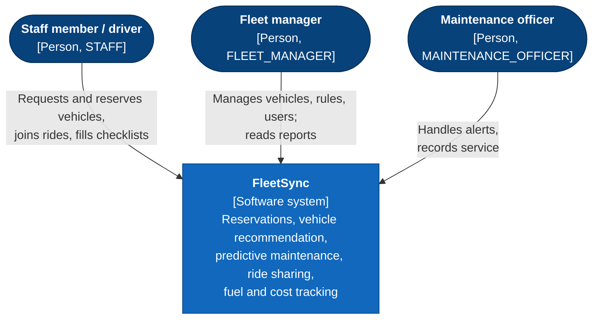
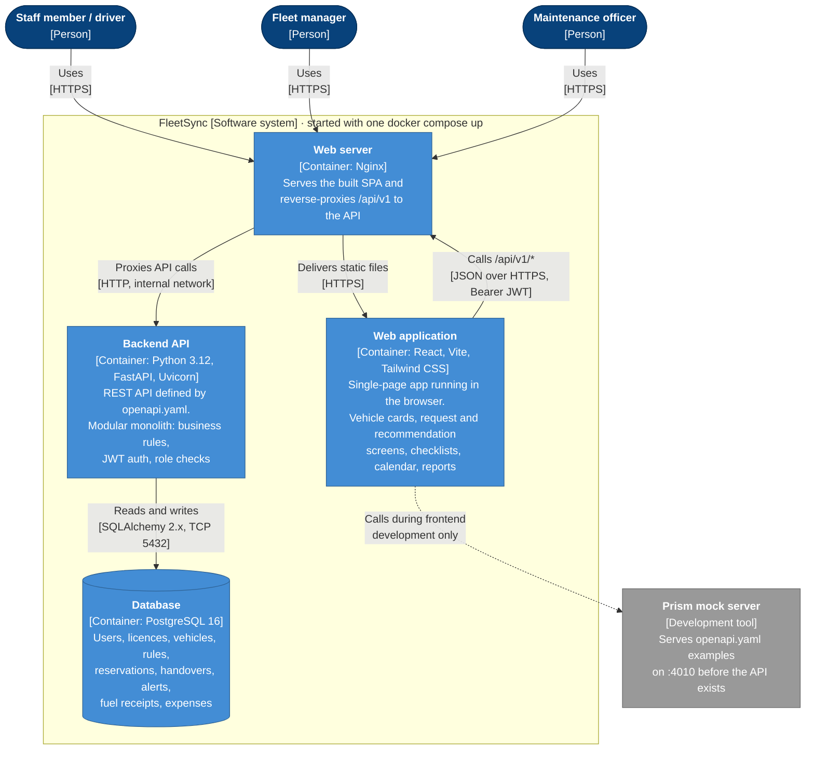
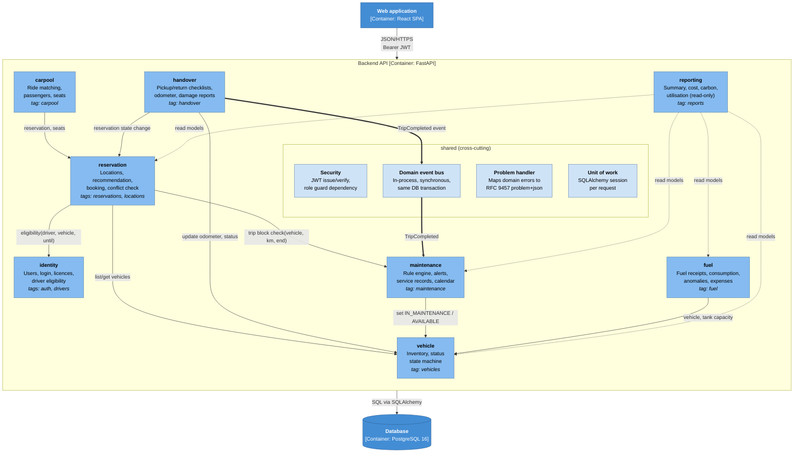
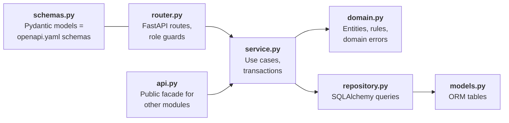

# FleetSync · C4 Architecture Model

| | |
|---|---|
| Course | SENG 321 Software Engineering · Sprint 2, deliverable 4 |
| Responsible / Accountable | Ali Eren Kurt, Lead Software Architect & Technical Lead |
| Consulted | Ahmet Tarık Orhan (Backend & API), Mustafa Düşünceli (Frontend & UI), Deniz Alp Oniki (DevOps) |
| Version | 1.0 · Sprint 2 · 2026-11-21 |
| Related documents | [`system_vision.md`](../system_vision.md) §6–§8, [`ADR-001`](../adr/ADR-001-python-fastapi.md), [`openapi.yaml`](../openapi.yaml), [`../uml/`](../uml/README.md) |
| Issue | #236 |

The model follows the [C4 model](https://c4model.com/): each level zooms into one box of the level above. Diagrams are written in Mermaid so that GitHub renders them and every change is visible in the diff.

| Level | Question it answers | Section |
|---|---|---|
| 1 · System context | Who uses FleetSync and what does it depend on? | [§1](#1-level-1--system-context) |
| 2 · Containers | Which deployable/runnable parts make up FleetSync? | [§2](#2-level-2--containers) |
| 3 · Components | Which modules make up the backend and how do they depend on each other? | [§3](#3-level-3--components-of-the-backend-api) |
| 4 · Code | Classes inside the modules | [`../uml/class_diagram.md`](../uml/class_diagram.md) |

## 1. Level 1 · System context

Defined in [`system_vision.md` §6](../system_vision.md#6-system-context-c4-level-1) and repeated here so the model reads top-down. There is no external system in release 1: no SSO, no map service, no email (see `system_vision.md` §7.3).



## 2. Level 2 · Containers



| Container | Technology | Responsibility | Owner |
|---|---|---|---|
| Web application | React, Vite, Tailwind CSS | All screens in [`ui_ux_flow_and_dashboard.md`](../ui_ux_flow_and_dashboard.md). Holds no business rules: it shows the reasons and error `code`s the API returns. API client generated from `openapi.yaml`. | Mustafa Düşünceli |
| Web server | Nginx | Single entry point on HTTPS. Serves the SPA build and proxies `/api/v1` so the browser sees one origin (no CORS in production). | Deniz Alp Oniki |
| Backend API | Python 3.12, FastAPI, SQLAlchemy 2.x, Pydantic, Uvicorn | Implements every operation in `openapi.yaml`, validates input, enforces the rules in `system_vision.md` §8, issues and checks JWTs. Stateless, so it can be restarted without losing sessions. | Ali Eren Kurt (architecture), module owners |
| Database | PostgreSQL 16 | The only persistent state. Schema and constraints in [`../uml/er_diagram.md`](../uml/er_diagram.md). Migrations run on API start (Alembic). Data kept in the `postgres_data` volume. | Ali Eren Kurt (schema), Deniz Alp Oniki (operations) |
| Prism mock server | `@stoplight/prism-cli` | Development only; lets the frontend work against the contract before the backend is ready ([`api_usage.md`](../api_usage.md)). Not part of the release. | Ahmet Tarık Orhan |

**Decisions reflected at this level**

- One backend process, not microservices: [ADR-001](../adr/ADR-001-python-fastapi.md).
- All traffic goes through one origin; the API is versioned under `/api/v1` (matches the first `servers` entry in `openapi.yaml`).
- No external systems in release 1, so there are no outbound arrows. Notifications are in-app only (open alerts read by the UI), see finding F1 in [`test_plans_and_coverage.md`](../test_plans_and_coverage.md).

## 3. Level 3 · Components of the Backend API

The backend is a modular monolith with one module per bounded context in `system_vision.md` §7.1. Each module has the same internal layering and exposes only a public `api.py` facade to other modules (ADR-001).



Every module also uses the `shared` components (security, problem handler, unit of work); those arrows are left out to keep the diagram readable.

### 3.1 Modules

| Module | Responsibility | Depends on (public API only) | Publishes / consumes events | Owner |
|---|---|---|---|---|
| `identity` | Accounts, password hashing, login and JWT, roles, driver profile, licences, licence verification, eligibility for a vehicle and period | – | – | Ahmet Can Vurmaz |
| `vehicle` | Vehicle registry, plate uniqueness, odometer (never decreases), status state machine ([`state_diagrams.md`](../uml/state_diagrams.md)) | – | – | Ali Eren Kurt |
| `maintenance` | Rules and intervals, per-vehicle maintenance plans, evaluation (`OK` / `DUE_SOON` / `DUE`), trip blocking check, alerts, service records, calendar | `vehicle` | consumes `TripCompleted`, `VehicleOdometerUpdated` | Ali Eren Kurt |
| `reservation` | Destinations, recommendation and scoring, reservation lifecycle, no-overlap rule | `identity`, `vehicle`, `maintenance` | publishes `ReservationCancelled` | Ahmet Tarık Orhan |
| `carpool` | Ride matching within the tolerance window, join/leave, seat accounting | `reservation` | consumes `ReservationCancelled` | Ahmet Tarık Orhan |
| `handover` | Checklist templates, pickup and return records, km limit check, damage reports | `reservation`, `vehicle` | publishes `TripCompleted`, `SevereDamageReported` | Mehmet Umut Oğuzcan |
| `fuel` | Fuel receipts, consumption between full tanks, anomaly detection, trip expenses | `vehicle`, `reservation` | – | Abdullah Tecimen |
| `reporting` | Fleet summary, cost, carbon, utilisation; read-only queries over the other modules' data | read access to all | – | Deniz Alp Oniki |

### 3.2 Inside a module

Every module uses the same folder layout. The layers depend inwards only.



```text
backend/app/
├── main.py                 # creates the FastAPI app, mounts routers under /api/v1
├── shared/                 # security, problem handler, event bus, unit of work, config
└── modules/
    ├── identity/   ├── vehicle/   ├── maintenance/   ├── reservation/
    ├── carpool/    ├── handover/  ├── fuel/          └── reporting/
        # each: api.py, router.py, schemas.py, service.py, domain.py, repository.py, models.py, events.py
```

### 3.3 Dependency rules

1. A module imports another module only through its `api.py`. Importing `models.py`, `repository.py` or `service.py` of another module is forbidden; an architecture test (import-linter) fails the CI build otherwise.
2. The dependency graph above has no cycles. When a lower module must react to a higher one (for example `maintenance` after a return in `handover`), it does so through a domain event, not a direct call.
3. Events are handled synchronously in the same database transaction (the return and the maintenance evaluation commit or roll back together, as `openapi.yaml` `recordReturn` requires).
4. `reporting` only reads. It may query other modules' tables through read-only views but never writes to them.
5. Pydantic schemas in `schemas.py` match `openapi.yaml`; a CI contract test compares `app.openapi()` with the file.

## 4. Traceability to the demo flow

| Demo step (`system_vision.md` §11) | Containers | Backend components |
|---|---|---|
| 1–2 Request, blocked vehicle, recommendation | SPA → Nginx → API → DB | `reservation` → `identity`, `vehicle`, `maintenance` |
| 3 Colleague joins the ride | SPA → API | `carpool` → `reservation` |
| 4 Pickup with checklist | SPA → API | `handover` → `reservation`, `vehicle` |
| 5 Return, service due, vehicle to maintenance, officer notified | SPA → API | `handover` → event bus → `maintenance` → `vehicle`; officer sees the `OPEN` alert |
| 6 Service recorded, vehicle available | SPA → API | `maintenance` → `vehicle` |
| 7 Reports | SPA → API | `reporting` |

Sequence diagrams for these steps: [`../uml/sequence_diagrams.md`](../uml/sequence_diagrams.md).

## 5. Open points

| # | Point | Owner | Status |
|---|---|---|---|
| C4-1 | Confirm Nginx as the web container and the HTTPS setup in `docker-compose.yml` | Deniz Alp Oniki | Open |
| C4-2 | F1 (notification) and F2 (CSV export) contract decisions may add endpoints to `maintenance` and `reporting`; the components stay the same | Ali Eren Kurt, Ahmet Can Vurmaz | Open |
| C4-3 | ADR-002 (modular monolith and dependency rules) records §3.3 as a decision | Ali Eren Kurt | Open |
