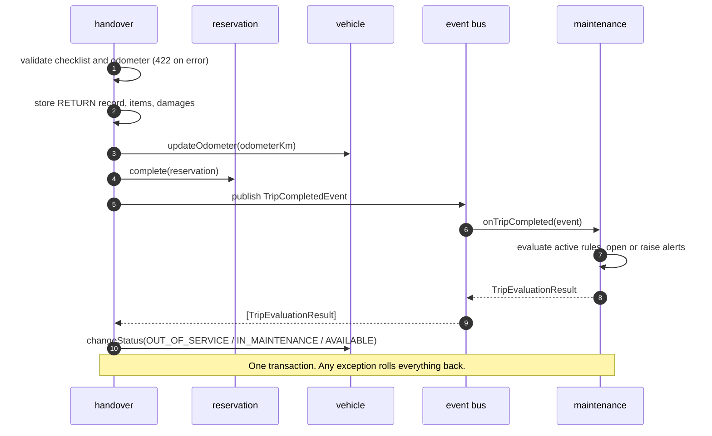

# FleetSync · Domain Event Contracts

> SENG 321 · Sprint 2. Owners: Mehmet Umut Oğuzcan (`handover`, publisher) and Ali Eren Kurt (Lead Architect, `maintenance` subscriber).
> Version 0.2 · 2026-11-21 · Status: **agreed by both owners** (decisions in §7).
> Related: [ADR-002](adr/ADR-002-modular-monolith.md) · [C4 §3.1](c4/README.md) · [SD-6](uml/sequence_diagrams.md) · [state machine](uml/state_diagrams.md) · [`openapi.yaml`](openapi.yaml) `recordReturn`

This is the single source for domain events in FleetSync. Domain events let a lower module react to a higher one without importing it (ADR-002 rule 3). Release 1 has one event between modules for the return flow: `TripCompletedEvent`.

## 1. General rules

| Rule | Decision |
|---|---|
| Base class | Every event derives from `DomainEvent` in `app/shared/events.py`, which adds `event_id` and `occurred_at`. |
| Naming | Past tense with the `Event` suffix: `TripCompletedEvent` (the name used in `openapi.yaml`, RACI, the sprint reports, issue #207, C4 and UML). |
| Location | The publisher owns the class: `backend/app/modules/<publisher>/events.py`, re-exported from its `api.py`. Subscribers import only from `api.py`. |
| Payload | Values and IDs only, never ORM objects. Immutable (`frozen=True`). |
| Time | `occurred_at` is timezone-aware UTC. |
| Delivery | Synchronous and in-process: the bus calls each handler immediately, inside the caller's database transaction (ADR-002 rule 4). |
| Failure | An exception in a handler aborts the request; the whole transaction rolls back and the client gets the error. No retry. |
| Duplicates | In a synchronous bus an event is never delivered twice; `event_id` is kept for logs and traceability. |

```python
# backend/app/shared/events.py
from dataclasses import dataclass, field
from datetime import datetime, timezone
from uuid import UUID, uuid4

@dataclass(frozen=True, kw_only=True)
class DomainEvent:
    event_id: UUID = field(default_factory=uuid4)
    occurred_at: datetime = field(default_factory=lambda: datetime.now(timezone.utc))
```

`kw_only=True` lets subclasses add required fields after the defaulted base fields.

## 2. `TripCompletedEvent`

**Publisher:** `handover`, in `POST /reservations/{reservationId}/return` (US-27), once per successful return.
**Subscriber:** `maintenance` · `MaintenanceRuleEngine.onTripCompleted()` (US-13).
**Purpose:** evaluate the vehicle's maintenance rules with the new odometer and date, and open or raise alerts.

| Field | Type | Meaning | Used by `maintenance` |
|---|---|---|---|
| `event_id` | UUID | From `DomainEvent` | Logs |
| `occurred_at` | datetime (UTC) | Time of the return, from `DomainEvent` | Date-based rules (`intervalMonths`) |
| `reservation_id` | UUID | Completed reservation | Alert traceability |
| `vehicle_id` | UUID | Returned vehicle | Rule evaluation |
| `odometer_km` | int | Odometer at return, already written to the vehicle | Km-based rules (`intervalKm`), `odometerKmAtAlert` |
| `trip_km` | int | `odometer_km` − pickup odometer | Alert message |
| `severe_damage_reported` | bool | At least one `SEVERE` damage in this return | No; read back by `handover` for the final status (§3) |

```python
# backend/app/modules/handover/events.py
from dataclasses import dataclass
from uuid import UUID

from app.shared.events import DomainEvent

@dataclass(frozen=True, kw_only=True)
class TripCompletedEvent(DomainEvent):
    reservation_id: UUID
    vehicle_id: UUID
    odometer_km: int
    trip_km: int
    severe_damage_reported: bool
```

**Example (demo step 5, `openapi.yaml` `recordReturn`):** 06 FS 102 returned at 60,020 km after a 570 km trip; the oil change is due at 60,000 km.

```json
{
  "eventId": "8f1c2b4e-1a7d-4c55-9b0e-2f3a4d5e6f70",
  "occurredAt": "2026-11-13T15:40:00Z",
  "reservationId": "3f6a0000-0000-4000-8000-0000000000a1",
  "vehicleId": "0b6f1c2a-0000-4000-8000-000000000102",
  "odometerKm": 60020,
  "tripKm": 570,
  "severeDamageReported": false
}
```

## 3. Result and final vehicle status

`maintenance` evaluates the rules and **returns its result; it does not change the vehicle status**.

```python
# backend/app/modules/maintenance/api.py
@dataclass(frozen=True)
class TripEvaluationResult:
    vehicle_id: UUID
    any_rule_due: bool                  # at least one rule is DUE
    alerts: list[MaintenanceAlertDto]   # alerts opened or raised in this evaluation
```

`handover` then sets the vehicle status **once**, from `IN_USE`:

| Severe damage in the return? | `any_rule_due`? | Final status | Transition (`state_diagrams.md` §1) |
|---|---|---|---|
| Yes | any | `OUT_OF_SERVICE` | `IN_USE → OUT_OF_SERVICE` |
| No | Yes | `IN_MAINTENANCE` | `IN_USE → IN_MAINTENANCE` |
| No | No | `AVAILABLE` | `IN_USE → AVAILABLE` |

One writer and one transition keep the state machine valid: if `maintenance` set `IN_MAINTENANCE` first, the following `OUT_OF_SERVICE` would be a transition the state machine does not allow. A severe-damage vehicle with a due rule still gets its alert; the workshop later moves it `OUT_OF_SERVICE → IN_MAINTENANCE` manually.

`handover` copies `alerts` into `ReturnResult.maintenanceAlerts` and the final status into `ReturnResult.vehicleStatus`.

## 4. Steps inside `recordReturn` (one transaction)

1. Validate: reservation `ACTIVE`; return odometer ≥ pickup odometer (else 422 `ODOMETER_DECREASED`); required checklist items present.
2. Store the `RETURN` handover record, its items and damages.
3. Compute `tripKm` and `kmLimitExceeded` (`tripKm > estimatedKm × 1.3`).
4. `vehicle.updateOdometer(odometerKm)`.
5. `reservation.complete()` → `COMPLETED`.
6. Publish `TripCompletedEvent` → `maintenance` returns `TripEvaluationResult`.
7. Set the final vehicle status with the table in §3.
8. Commit and respond `201 ReturnResult`.



## 5. Damage reports

`handover` sets `OUT_OF_SERVICE` for a `SEVERE` damage by calling `vehicle/api.py` directly (allowed dependency `handover → vehicle`); no event is published. A `SevereDamageReported` event can be added later if a notification subscriber needs it.

## 6. Tests

| Owner | Level | Test |
|---|---|---|
| `maintenance` (Ali Eren Kurt) | Unit | `onTripCompleted` thresholds (US-13): 9,999 km → no `DUE`; 10,000 and 10,050 km → `DUE`, `any_rule_due=True`; an open `DUE_SOON` alert is raised, not duplicated |
| `handover` (Mehmet Umut Oğuzcan) | Integration | Full return: event published once with the right values (60,020 km, `trip_km = 570`); final status follows §3; a failing handler rolls back the return (reservation stays `ACTIVE`, no `RETURN` record) — task T-27.3 (#207) |
| QA (Abdullah Tecimen) | E2E | Demo step 5 |

## 7. Decisions (review with the Architect, 2026-11-21)

| # | Topic | Decision |
|---|---|---|
| D1 | `VehicleOdometerUpdated` | Removed. The odometer changes only during a return, and `TripCompletedEvent` covers that moment; two events would run the rules twice. Removed from C4 §3.1. |
| D2 | `SevereDamageReported` | Removed: no subscriber. `handover` calls `vehicle/api.py` directly (§5). Removed from C4 §3.1. |
| D3 | Payload | `event_id`, `occurred_at`, `reservation_id`, `vehicle_id`, `odometer_km`, `trip_km`, `severe_damage_reported` (§2). |
| D4 | Tests | Unit tests in `maintenance`; integration test of the whole return in `handover` (§6). |
| D5 | Single document | This file replaces `docs/trip_completed_event.md`; diagrams link here. |
| D6 | Vehicle status | `maintenance` returns the result; `handover` changes the status once (§3). |
| D7 | Name | `TripCompletedEvent`, derived from `DomainEvent`. |

## 8. Traceability

| Item | Link |
|---|---|
| Stories | US-27 (#129), US-28 (#130), US-13 (#98) |
| Task | T-27.3 Publish TripCompletedEvent (#207) |
| Endpoint | `POST /reservations/{reservationId}/return` → `ReturnResult` |
| Diagrams | SD-6 in `uml/sequence_diagrams.md`; class diagram `MaintenanceRuleEngine`; vehicle state machine in `uml/state_diagrams.md` |

## 9. Approval

| Role | Name | Decision | Date |
|---|---|---|---|
| Publisher owner (`handover`) | Mehmet Umut Oğuzcan | Approved | 2026-11-21 |
| Subscriber owner (`maintenance`), Lead Architect | Ali Eren Kurt | Approved in review, pending this revision | 2026-11-21 |
