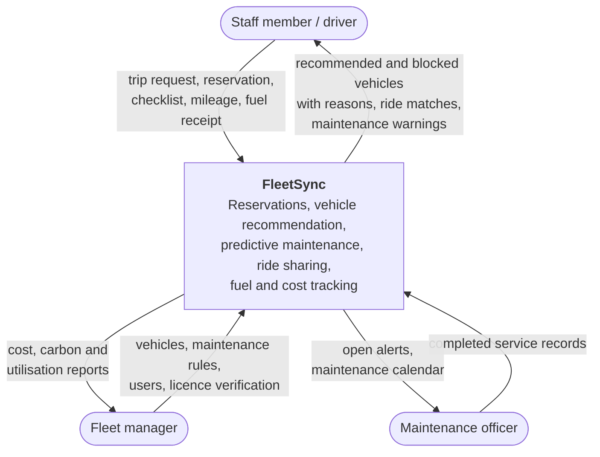

# FleetSync · System Vision and System Boundary

| | |
|---|---|
| Course | SENG 321 Software Engineering · Sprint 1, deliverable 2 |
| Responsible (R) | Ali Eren Kurt, Lead Software Architect |
| Accountable (A) | Ahmet Can Vurmaz, Product Owner |
| Consulted (C) | Abdullah Tecimen (QA), Ahmet Tarık Orhan (Backend), Mustafa Düşünceli (Frontend) |
| Version | 0.2 (updated for Sprint 1) · 2026-10-25 |
| Related documents | `problem_definition.md` (proposal), [`openapi.yaml`](openapi.yaml) (API contract), [`raci_matrix.md`](raci_matrix.md) |
| Repository | https://github.com/denizalponiki/Fleet-Tracking-System · License: MIT |

## 1. Purpose of this document

This document states what FleetSync is for, who uses it, which systems it talks to, and where its responsibility ends. It defines the scope of the first release. The project proposal, the OpenAPI contract and the initial backlog must describe the same release; when they disagree, this document is updated first and the others follow.

## 2. Vision statement

> **For** institutions and campuses that run a shared vehicle fleet,
> **who** assign vehicles by phone, email and spreadsheets and track maintenance by hand,
> **FleetSync** is a web-based fleet management platform
> **that** recommends only vehicles that are safe to use for a trip, blocks vehicles whose maintenance is close, raises maintenance alerts automatically from mileage and dates, and lets staff travelling to the same destination share one vehicle.
> **Unlike** spreadsheets and generic booking calendars, FleetSync applies the same reservation, licence and maintenance rules to every request and keeps a complete history of who used which vehicle and in what condition.

## 3. Problem summary

The full problem analysis is in the project proposal. In short:

- Vehicles are requested informally, so the same vehicle can be promised to two people and nobody sees the full calendar.
- Oil change, tyre and inspection dates are tracked manually; vehicles that are due for service still go on trips.
- Several staff members drive separate vehicles to the same destination on the same day.
- Mileage, fuel receipts and damage are recorded on paper or not at all, so cost, fuel anomalies and carbon footprint are invisible.

## 4. Goals and success measures for release 1

| # | Goal | Measure | Target |
|---|---|---|---|
| G1 | No trip starts with a vehicle that is due for maintenance | Trips started with a vehicle whose remaining service distance is below trip distance + 100 km | 0 |
| G2 | No double bookings | Overlapping confirmed reservations for the same vehicle | 0 |
| G3 | Maintenance is triggered by data, not by memory | Returns that cross a service threshold and do not create an alert and move the vehicle to maintenance | 0 |
| G4 | Requesting a vehicle is fast | Time for a staff member to complete a valid request (usability test with the Figma prototype) | < 2 minutes |
| G5 | Fewer vehicles for the same trip | Requests that join an existing ride instead of taking another vehicle | Reported by the system |
| G6 | Fleet cost and emissions are visible | Cost, carbon and utilisation reports available per vehicle and period | Available |

## 5. Users and stakeholders

### 5.1 Users (actors)

| Actor | Goals | What they do in FleetSync |
|---|---|---|
| **Staff member / driver** (`STAFF`) | Get a suitable vehicle for an official trip with little effort | Requests vehicles, sees recommendations, reserves, joins shared rides, completes pickup and return checklists, enters mileage, fuel receipts and expenses |
| **Fleet manager** (`FLEET_MANAGER`) | Keep the fleet available, safe and affordable | Manages vehicles, maintenance rules and users, verifies driving licences, sees all reservations, reads cost / carbon / utilisation reports |
| **Maintenance officer** (`MAINTENANCE_OFFICER`) | Service vehicles on time | Receives maintenance alerts, sees the maintenance calendar, records completed service and returns vehicles to use |

### 5.2 Other stakeholders

| Stakeholder | Interest | Relation to the system |
|---|---|---|
| Institution management | Fair, safe and cost-effective use of vehicles | Sponsor; consumes reports, does not use the system daily |
| Passengers in shared rides | A seat on a trip they need | Staff members who join a ride; same role as `STAFF` |
| Vehicle workshop | Receives vehicles for service | Outside the system; the maintenance officer records its work |
| Course instructor and jury | Assess the product | Not a system user |

## 6. System context

The diagram shows FleetSync as one system. Every arrow names the information exchanged and why.

| From → To | Information | Purpose |
|---|---|---|
| Staff → FleetSync | Destination, period, seats, estimated distance, purpose | Find and reserve a suitable vehicle |
| FleetSync → Staff | Recommended vehicles, blocked vehicles with reasons, shared ride matches | Let the staff member choose safely and share rides |
| Staff → FleetSync | Pickup / return checklist, odometer reading, fuel level, damage | Record vehicle condition and mileage; trigger maintenance evaluation |
| Staff → FleetSync | Fuel receipts and trip expenses | Track consumption, detect anomalies, calculate cost |
| Fleet manager → FleetSync | Vehicle data, maintenance intervals, user accounts, licence verification | Keep master data and rules correct |
| FleetSync → Fleet manager | Cost, carbon footprint, utilisation, fuel anomalies | Decide on fleet use and budget |
| FleetSync → Maintenance officer | Open alerts, expected service dates | Plan service before vehicles become unsafe |
| Maintenance officer → FleetSync | Completed service (rules, odometer, date, cost) | Reset service intervals and release the vehicle |

All users reach FleetSync through a web browser over HTTPS. There is no other client in release 1.

## 7. System boundary

### 7.1 Inside: responsibilities of FleetSync

| Capability | Responsibility | Module · API tag | Owner |
|---|---|---|---|
| Identity and access | Accounts, login with JWT, the three roles, role checks on every operation | `identity` · `auth` | Ahmet Can Vurmaz |
| Driver eligibility | Driving licences, verification by the fleet manager, licence class and validity check for each trip | `identity` · `drivers` | Ahmet Can Vurmaz |
| Fleet inventory | Vehicles, seat count, fuel type, required licence class, odometer, the vehicle status state machine | `vehicle` · `vehicles` | Ali Eren Kurt |
| Predictive maintenance | Mileage- and date-based rules (oil change, tyres, inspection), remaining km / days, alerts, blocking vehicles before trips, service records, maintenance calendar | `maintenance` · `maintenance` | Ali Eren Kurt |
| Reservations | Destinations, vehicle recommendation, reservation lifecycle, conflict prevention | `reservation` · `reservations`, `locations` | Ahmet Tarık Orhan |
| Ride sharing | Matching requests with existing trips to the same destination, passengers and seats | `carpool` · `carpool` | Ahmet Tarık Orhan |
| Handover | Pickup and return checklists, odometer and fuel level, damage reports, mileage limit check | `handover` · `handover` | Mehmet Umut Oğuzcan |
| Fuel and expenses | Fuel receipts, consumption per 100 km, anomaly detection, trip expenses | `fuel` · `fuel` | Abdullah Tecimen |
| Reporting | Cost, carbon footprint, utilisation, fleet summary, CSV export | `reporting` · `reports` | Deniz Alp Oniki |
| User interface | Vehicle status cards, request and recommendation screens, checklists, maintenance calendar, reports | `frontend` | Mustafa Düşünceli |
| Notifications | Deciding when to notify whom and with what message (handled within the app UI) | `shared` | Ali Eren Kurt |

### 7.2 Outside: external systems FleetSync depends on

| External system | Used for | Interface | Release 1 |
|---|---|---|---|
| Web browser | Running the user interface | HTTPS, HTML / JavaScript | Required |

### 7.3 Deferred to later releases

| Capability | Why it is deferred |
|---|---|
| Single sign-on with the institution's identity provider (LDAP / SAML / OAuth) | Needs access we do not have; release 1 uses its own accounts with the same three roles |
| Live GPS tracking and route planning with a map service | External paid API and device integration; destinations are predefined with known distances |
| Mobile application | The web interface is responsive and covers the demo |
| Approval workflow for reservations | Release 1 confirms valid reservations immediately; the rules already block unsafe requests |
| Automatic reading of fuel receipts (OCR) | Receipts are entered manually |
| Email notifications | Deferred to avoid inconsistency between the documentation and the prototype code for the jury demo. In-app notifications will suffice for Release 1. |

### 7.4 Explicitly excluded

- Repairing or servicing vehicles. FleetSync records that service was done; the workshop does the work.
- Payments, fines, fuel cards and insurance claims.
- Purchasing, selling or leasing vehicles, and demand forecasting for the fleet.
- Payroll or travel allowance calculations for drivers.

## 8. Core rules owned by the system

These rules define the system's behaviour at the boundary and are implemented in the backend, not left to users.

| Rule | Definition |
|---|---|
| Maintenance intervals | Oil change every 10,000 km or 12 months; tyre replacement every 40,000 km or 48 months; periodic inspection every 24 months. Intervals are data and can be changed by the fleet manager. |
| Warning threshold | A rule is `DUE_SOON` within 1,000 km / 30 days (tyres: 2,000 km / 60 days) and `DUE` when the interval is reached. |
| Trip blocking | A vehicle is not offered for a trip when, for any rule, remaining km < estimated trip km + 100 km safety buffer, or the due date falls before the trip ends. |
| Automatic maintenance status | When a returned vehicle's mileage makes any rule `DUE`, the system opens an alert and sets the vehicle to `IN_MAINTENANCE`. Only a service record returns it to `AVAILABLE`. |
| No double booking | A vehicle cannot have two confirmed or active reservations with overlapping periods. |
| Driver eligibility | The driver needs a verified licence of a class that allows the vehicle, valid until the trip ends. |
| Mileage integrity | Odometer readings never go backwards. A trip more than 30% longer than estimated is flagged. |
| Ride sharing | A request matches a trip with the same destination, departure within the tolerance window (default 30 minutes) and enough free seats. |
| Fuel anomaly | Consumption more than 25% above the vehicle's average, or litres above tank capacity, is flagged. |

## 9. Assumptions

| # | Assumption | If it turns out false |
|---|---|---|
| A1 | Drivers enter the odometer reading honestly at pickup and return | Mileage-based rules become unreliable; a photo of the odometer could be added later |
| A2 | Trip destinations come from a predefined list with known road distances | A map service would be needed (deferred) |
| A3 | Each vehicle has one active reservation at a time; passengers join it instead of booking separately | The reservation model would need multi-driver trips |
| A4 | The fleet manager verifies licences from the physical document | No automatic check with the licence authority is possible |
| A5 | Users have a modern web browser and network access on campus | Offline use would require a mobile app (deferred) |
| A6 | Fleet size is in the tens of vehicles and hundreds of users | Performance targets and data model would need review for thousands |

## 10. Constraints

| Type | Constraint |
|---|---|
| Schedule | 10 weeks, four assessed deliveries (weeks 2, 5, 8, 10) |
| Team | 7 members, each with a named role and visible individual contributions |
| Process | API-first: the OpenAPI contract is agreed before implementation; Git-Flow with protected `main` and `develop`; every change through a reviewed pull request |
| Architecture | Web front end + REST API + relational database; a modular monolith with one module per capability in section 7.1 |
| Deployment | The whole product starts with one `docker compose up` command, including seed data for the demo |
| Quality | At least 50% unit test coverage enforced in CI; automated integration and end-to-end tests; SonarQube static analysis |
| Licensing | Released under the MIT License; every dependency must have a compatible open-source license |
| Legal / ethical | Names, emails, phone numbers and licence numbers are personal data under the Turkish Personal Data Protection Law (KVKK, Law No. 6698). FleetSync stores only what the rules need, shows licence data only to the owner and fleet managers, and uses invented data in the demo. |
| Security | Passwords stored only as salted hashes; every API call except login requires a token; role checks on the server |

## 11. Release 1 at a glance

The release is complete when the jury demo runs end to end:

1. A staff member requests a vehicle for a trip.
2. FleetSync blocks the vehicle whose service is close, explains why, and recommends a suitable one.
3. A colleague travelling to the same destination joins the ride.
4. The driver picks up the vehicle with the checklist.
5. On return the driver enters the current mileage; FleetSync raises "10,000 km service is due", moves the vehicle to maintenance and notifies the maintenance officer.
6. The maintenance officer records the service and the vehicle becomes available again.
7. The fleet manager sees cost, carbon and utilisation for the period.

## 12. Glossary

| Term | Meaning |
|---|---|
| Reservation | A confirmed booking of one vehicle by one driver for a period and destination |
| Ride sharing / carpool | Other staff members joining an existing reservation as passengers |
| Handover | Pickup or return of a vehicle, recorded with a checklist |
| Maintenance rule | A service interval in km and / or months, with a warning threshold |
| Maintenance plan | The last service km and date of one rule on one vehicle |
| Alert | A record that a rule is `DUE_SOON` or `DUE` for a vehicle |
| Safety buffer | The extra 100 km a vehicle must have left before its next service, on top of the trip distance |
| Utilisation | Reserved hours divided by available working hours of a vehicle |

## 13. Approval

| Role | Name | Decision | Date |
|---|---|---|---|
| Product Owner (A) | Ahmet Can Vurmaz | Approved | 2026-10-25 |
| Lead Software Architect (R) | Ali Eren Kurt | | |