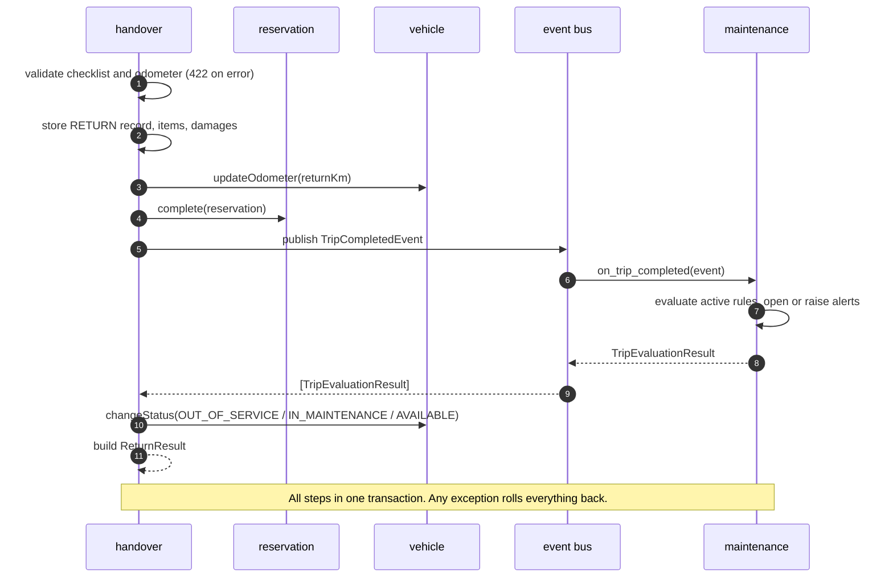

# FleetSync · `TripCompletedEvent` Contract

| | |
|---|---|
| Course | SENG 321 Software Engineering · Sprint 2 |
| Publisher | `handover` module, Mehmet Umut Oğuzcan |
| Subscriber | `maintenance` module, Ali Eren Kurt |
| Status | **Proposed**: to be agreed by both owners in review |
| Version | 0.1 · 2026-11-21 |
| Related | [`openapi.yaml`](openapi.yaml) `recordReturn`, [ADR-002](adr/ADR-002-modular-monolith.md), [`uml/sequence_diagrams.md`](uml/sequence_diagrams.md) SD-6, [`uml/state_diagrams.md`](uml/state_diagrams.md) §1, [`c4/README.md`](c4/README.md) §3 |
| Issue | #267 |

## 1. Purpose

When a driver returns a vehicle (`POST /reservations/{reservationId}/return`), the `handover` module records the return and the `maintenance` module must evaluate the service rules with the new odometer reading (demo step 5, US-13). ADR-002 forbids `handover` from calling into `maintenance`'s internals, and `maintenance` must not depend on `handover`. The two modules therefore communicate through one in-process domain event, `TripCompletedEvent`. This document is the contract both sides implement and test against.

## 2. Decisions

| # | Topic | Decision |
|---|---|---|
| D1 | Name | `TripCompletedEvent`, as already used in `openapi.yaml` and `raci_matrix.md`. C4, UML and ADR-002 are aligned in this PR. |
| D2 | Owner of the class | The publisher: defined in `backend/app/modules/handover/events.py`. `maintenance` imports it through `handover.api` (ADR-002 rule 2). |
| D3 | Delivery | Synchronous, in the same database transaction as the return, through `app.shared.events.bus` (ADR-002 rule 4). |
| D4 | When it is published | After the return record is stored, the vehicle odometer is updated and the reservation is `COMPLETED`; before the vehicle status is changed. |
| D5 | What `maintenance` does | Evaluates every active rule for the vehicle, opens or raises alerts, and **returns its result**. It does **not** change the vehicle status itself. |
| D6 | Who sets the final vehicle status | `handover`, once, from `IN_USE`, using the result: see §4. |
| D7 | Failure | Any exception in a handler aborts the request; the whole return is rolled back and the client gets the error. No retry, no partial return. |
| D8 | Idempotency | Published exactly once per reservation. A second return for the same reservation is already rejected with `409 INVALID_RESERVATION_STATE`, and the database allows only one `RETURN` record per reservation (`er_diagram.md`). |

## 3. Payload

```python
# backend/app/modules/handover/events.py
from dataclasses import dataclass
from datetime import datetime
from uuid import UUID

from app.shared.events import DomainEvent


@dataclass(frozen=True)
class TripCompletedEvent(DomainEvent):
    reservation_id: UUID
    vehicle_id: UUID
    driver_id: UUID
    pickup_odometer_km: int
    return_odometer_km: int      # already written to the vehicle (D4)
    trip_km: int                 # return_odometer_km - pickup_odometer_km
    estimated_km: int
    km_limit_exceeded: bool      # trip_km > estimated_km * 1.3
    severe_damage_reported: bool # at least one SEVERE damage in this return
    returned_at: datetime        # timezone-aware
```

| Field | Used by `maintenance` | Why it is in the event |
|---|---|---|
| `vehicle_id`, `return_odometer_km`, `returned_at` | Yes: rule evaluation by km and by date | Core input of the rule engine |
| `reservation_id`, `trip_km`, `pickup_odometer_km` | Yes: alert message and `odometerKmAtAlert` | Traceability of the alert to the trip |
| `driver_id`, `estimated_km`, `km_limit_exceeded`, `severe_damage_reported` | No (release 1) | Lets future subscribers (for example reporting or notifications) react without changing the publisher |

The event carries values, never ORM objects, and is immutable.

## 4. Return value and final vehicle status

```python
# backend/app/modules/maintenance/api.py
@dataclass(frozen=True)
class TripEvaluationResult:
    vehicle_id: UUID
    any_rule_due: bool                  # at least one rule is DUE
    alerts: list[MaintenanceAlertDto]   # alerts opened or raised during this evaluation
```

`bus.publish(event)` returns one `TripEvaluationResult` from the maintenance handler. `handover` then sets the vehicle status **once**, from `IN_USE`:

| Severe damage in the return? | `any_rule_due`? | Final vehicle status | Allowed transition (`state_diagrams.md` §1) |
|---|---|---|---|
| Yes | any | `OUT_OF_SERVICE` | `IN_USE → OUT_OF_SERVICE` |
| No | Yes | `IN_MAINTENANCE` | `IN_USE → IN_MAINTENANCE` |
| No | No | `AVAILABLE` | `IN_USE → AVAILABLE` |

A severe-damage vehicle with a due rule still gets its maintenance alert; when the workshop takes it, the status goes `OUT_OF_SERVICE → IN_MAINTENANCE` (manual) and later `IN_MAINTENANCE → AVAILABLE` with the service record.

**Why `handover` sets the status and not `maintenance`:** if both modules changed the status, the second write would depend on handler order, and `IN_MAINTENANCE → OUT_OF_SERVICE` is not an allowed transition. One writer, one transition from `IN_USE`, keeps the state machine valid. The rule that decides *whether* service is due stays in `maintenance`.

`handover` copies `alerts` into `ReturnResult.maintenanceAlerts` and the final status into `ReturnResult.vehicleStatus` (`openapi.yaml`).

## 5. Sequence inside `recordReturn`



## 6. Tests

| Owner | Test | Example |
|---|---|---|
| `handover` (Mehmet Umut Oğuzcan) | The event is published once with the right values | Return at 60,020 km after pickup at 59,450 km → `trip_km = 570` |
| `handover` | Final status follows §4 | Fake handler returns `any_rule_due=True` → `IN_MAINTENANCE`; severe damage → `OUT_OF_SERVICE` |
| `handover` | Handler error rolls back the return | Fake handler raises → reservation still `ACTIVE`, no `RETURN` record |
| `maintenance` (Ali Eren Kurt) | Handler opens alerts at the right thresholds | US-13: 9,999 km → no `DUE`; 10,000 km and 10,050 km → `DUE` alert, `any_rule_due=True` |
| `maintenance` | No duplicate open alert | Existing `DUE_SOON` alert is raised to `DUE`, not duplicated |
| QA (Abdullah Tecimen) | End-to-end return flow | TC-E2E for demo step 5 |

Each module tests its side with a fake of the other side, so neither waits for the other in Sprint 3.

## 7. Open questions for the review

| # | Question | Proposal |
|---|---|---|
| Q1 | Should a `DUE_SOON` result also be shown to the driver in `ReturnResult.maintenanceAlerts`? | Yes, every alert opened or raised in this evaluation is returned |
| Q2 | Should `kmLimitExceeded` create a record of its own? | Not in release 1; it is returned in `ReturnResult` and carried in the event for later use |
| Q3 | Severe damage reported outside a return while the vehicle is `IN_USE` (SM-1) | Store the report; apply `OUT_OF_SERVICE` at return through `severe_damage_reported` |

## 8. Approval

| Role | Name | Decision | Date |
|---|---|---|---|
| Publisher owner (`handover`) | Mehmet Umut Oğuzcan | | |
| Subscriber owner (`maintenance`), Lead Architect | Ali Eren Kurt | | |
