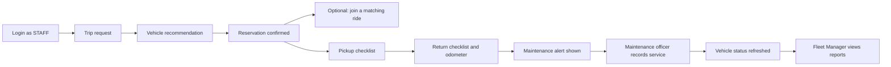

# FleetSync · UI/UX Flow and Dashboard

| | |
|---|---|
| Course | SENG 321 Software Engineering · Sprint 1 |
| Owner | Mustafa Düşünceli · Implementation & Integration Engineer (Frontend & UI) |
| Version | 0.1 · Sprint 1 (initial draft) |
| Related documents | `system_vision.md`, `product_backlog.md` (Epic E9), `openapi.yaml`, `raci_matrix.md` |

## 1. Purpose

This document defines the planned screens for FleetSync, which roles can access them, the main flow between screens, and the API operations each screen consumes. It is an initial planning document for Sprint 1; detailed Figma prototypes and frontend implementation belong to later sprints.

The initial frontend task notes propose React with Vite and Tailwind CSS. They also propose using a Prism mock server at `http://localhost:4010` before the backend is ready. These are proposed development choices and should be confirmed against the team's final frontend setup before implementation.

## 2. Screens per role

| Role | Planned screens |
|---|---|
| Staff member / driver (`STAFF`) | Login; Trip request & recommendation; My reservations; Ride matches; Pickup checklist; Return checklist; Fuel receipt form & history |
| Fleet manager (`FLEET_MANAGER`) | Login; Vehicle status cards; All reservations; Users & licence verification; Reports dashboard |
| Maintenance officer (`MAINTENANCE_OFFICER`) | Login; Maintenance alerts; Maintenance calendar; Record service |

The frontend should show navigation items according to the authenticated user's role. This is a user-interface measure only; the backend must enforce authorization for every protected operation.

## 3. Screen list and API mapping

| Screen | What it shows | User story | Target | API operations |
|---|---|---|---|
| Login | Email and password fields, input validation, authentication result, and navigation to the pages available to the signed-in role. A user without a valid session is directed to login before accessing a protected page. | US-38 | Sprint 3 | `POST /auth/login`; `GET /me` |
| Vehicle status cards | A card for each vehicle showing its plate, vehicle type, seat count, current odometer, status, and the maintenance summary provided by the API. Vehicles with due or due-soon maintenance should be visually distinguishable. | US-39 | Sprint 3 | `GET /vehicles` |
| Trip request & recommendation | A trip form for destination, start and end time, required seats, and estimated distance. After submission, the screen separates recommended vehicles from blocked vehicles and displays the warning or blocking reasons returned by the API. The user can reserve a selected recommended vehicle and see the result. | US-40 | Sprint 3 | `GET /locations`; `GET /vehicles/recommendations`; `POST /reservations` |
| Ride matches | Matching rides with relevant trip information, departure time, driver information, and available seats. The user can join a ride and receive confirmation or a clear error if joining is not possible. | US-41 | Sprint 3 | `GET /rides/matches`; `POST /reservations/{reservationId}/passengers` |
| Pickup / return checklist | Separate pickup and return checklist screens. They display the checklist items and collect the required handover information, including odometer and condition details as defined by the API. The result view shows the outcome returned by the backend, including any maintenance alert generated after return. | US-42 | Sprint 3 | `GET /checklist-templates`; `POST /reservations/{reservationId}/pickup`; `POST /reservations/{reservationId}/return` |
| Maintenance alerts & calendar | A list of maintenance alerts, a calendar of expected maintenance, and a form for recording completed service. After a service record is submitted, the screen refreshes the alert and vehicle information using the API response. | US-43 | Sprint 3 | `GET /maintenance/alerts`; `GET /maintenance/calendar`; `POST /maintenance/records` |
| Fuel receipt form & history | A form to record a fuel receipt and a vehicle-specific history of receipts. Validation feedback is shown for invalid values; any anomaly information returned by the API is presented to the relevant user. | US-44 | Final | `POST /fuel-receipts`; `GET /vehicles/{vehicleId}/fuel-receipts` |
| Reports dashboard | A selected-period dashboard showing fleet summary, cost, carbon footprint, and vehicle utilisation information. Access is restricted to the Fleet Manager role. | US-45 | Final | `GET /reports/summary`; `GET /reports/cost`; `GET /reports/carbon`; `GET /reports/utilization` |

### Supporting role screens

The role overview includes supporting screens that do not have a separate story in Epic E9. They are listed here so that the initial navigation plan is complete.

| Supporting screen | What it shows | API operations |
|---|---|---|
| My reservations / All reservations | Staff members see their own reservations and rides they joined as passengers; Fleet Managers can see all reservations. The screen shows reservation and trip details and provides cancellation where the reservation state allows it. | `GET /reservations`; `POST /reservations/{reservationId}/cancel` |
| Users & licence verification | Fleet Managers can browse users, inspect a driver's profile and licence records, and record that a licence has been verified after checking the physical document. | `GET /users`; `GET /drivers/{driverId}`; `GET /drivers/{driverId}/licenses`; `POST /drivers/{driverId}/licenses/{licenseId}/verify` |

## 4. Main demo flow

The main user journey starts with a staff member requesting a vehicle, continues through recommendation and handover, and ends with maintenance follow-up. Ride matching can be shown after the reservation is created. The Fleet Manager's reports view is a later dashboard step.

The recommendation screen must distinguish suitable vehicles from blocked vehicles and display the reasons returned by the API. On return, the backend runs the maintenance rules; the frontend displays the returned result and must not independently decide whether a vehicle is eligible or due for service. Any maintenance threshold shown in a demo must come from the team's configured rule, not from a hard-coded universal assumption.

## 5. UI and API integration principles

- **Role-aware navigation:** show the pages and menu items relevant to the authenticated user's role. The backend remains responsible for authorization.
- **API as the source of truth:** do not make final reservation, licence-eligibility, vehicle-status, or maintenance decisions only in the browser. Display the decision and reason returned by the API.
- **Request states:** provide loading, success, empty, and error states for data-driven screens. Prevent duplicate form submissions while a request is in progress.
- **Validation and errors:** validate required inputs before sending a request and also handle backend validation responses. For `application/problem+json` errors, use the API's `code` and safe user-facing detail; do not expose stack traces or raw technical information.
- **Dates and pagination:** follow the date-time formats and pagination parameters defined by the OpenAPI contract.
- **Accessible status display:** use readable status text as well as colour or icons. Do not communicate vehicle or maintenance status by colour alone; use the status values defined by the API.
- **Responsive layout:** plan navigation, cards, tables, and forms so that they remain usable on narrow screens and desktop displays. Detailed responsive design will be refined in the later prototype and implementation stages.

---

*This is an initial Sprint 1 planning document. Update it if the team changes the role model, screen scope, OpenAPI contract, frontend technology, or sprint targets.*
