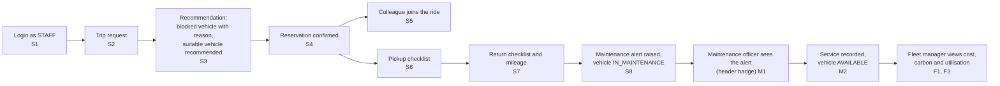
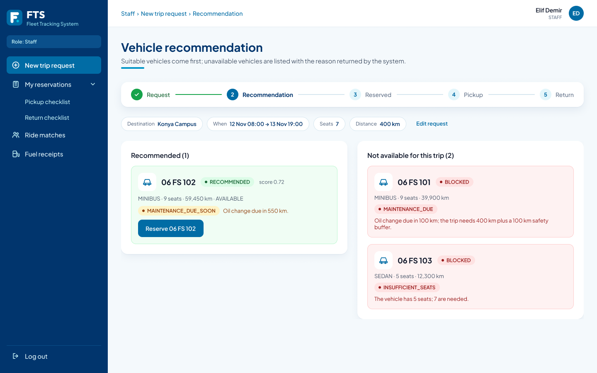
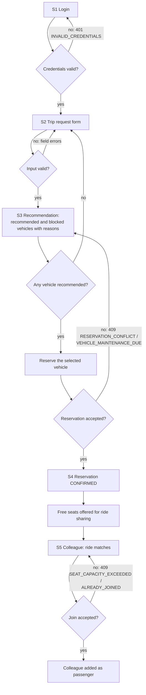
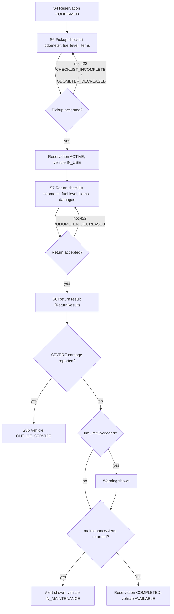
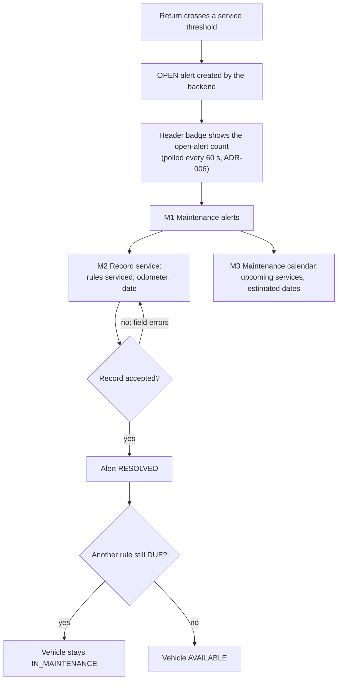
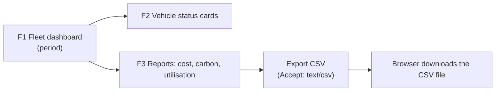

# FleetSync · UI/UX Flow and Dashboard

| | |
|---|---|
| Course | SENG 321 Software Engineering · Sprint 2 |
| Owner | Mustafa Düşünceli · Implementation & Integration Engineer (Frontend & UI) |
| Version | 0.2.1 · Sprint 2 · 2026-11-22 (review of PR #292 applied) |
| Issue | #255 (Sprint 2: Figma prototypes and user-flow diagrams) |
| Related documents | `system_vision.md`, `srs/srs.md`, `product_backlog.md` (Epic E9), `openapi.yaml`, `nfr_quality_measures.md`, `adr/ADR-003-error-format-rfc9457.md`, `adr/ADR-006-notifications-and-csv-export.md`, `raci_matrix.md` |

## 1. Purpose

This document defines the screens of FleetSync, which roles can access them, the main flow between screens, and the API operations each screen consumes. Version 0.1 (Sprint 1) listed the planned screens. Version 0.2 (Sprint 2) adds the Figma prototypes (§6), the user-flow diagrams (§7) and an accessibility check of the prototype (§8). The frontend itself is implemented in Sprint 3 (US-38 to US-43) and Final (US-44, US-45).

The web application is built with React, Vite and Tailwind CSS (`srs/srs.md` §2, `c4/README.md`). Until the backend is ready it is developed against the Prism mock server at `http://localhost:4010` (`api_usage.md`). The Figma prototype does not depend on a component library; its components (§6.3) are implemented as Tailwind components in Sprint 3.

## 2. Screens per role

| Role | Screens | Prototype |
|---|---|---|
| Staff member / driver (`STAFF`) | Login; Trip request & recommendation; My reservations; Ride matches; Pickup checklist; Return checklist; Fuel receipt form & history | S1–S9 |
| Fleet manager (`FLEET_MANAGER`) | Login; Dashboard; Vehicle status cards; Reports (cost, carbon footprint, utilisation); All reservations; Users & licence verification | F1–F3 (All reservations and Users & licence verification are not prototyped yet) |
| Maintenance officer (`MAINTENANCE_OFFICER`) | Login; Maintenance alerts; Maintenance calendar; Record service | M1–M3 |

The frontend shows navigation items according to the authenticated user's role. This is a user-interface measure only; the backend must enforce authorization for every protected operation.

## 3. Screen list and API mapping

| Screen | What it shows | User story | Target | API operations |
|---|---|---|---|---|
| Login | Email and password fields, input validation, authentication result, and navigation to the pages available to the signed-in role. A user without a valid session is directed to login before accessing a protected page. | US-38 | Sprint 3 | `POST /auth/login`; `GET /me` |
| Vehicle status cards | A card for each vehicle showing its plate, vehicle type, seat count, current odometer, status, and the maintenance summary provided by the API. Vehicles with due or due-soon maintenance should be visually distinguishable. | US-39 | Sprint 3 | `GET /vehicles` |
| Trip request & recommendation | A trip form for destination, start and end time, required seats, and estimated distance. After submission, the screen separates recommended vehicles from blocked vehicles and displays the warning or blocking reasons returned by the API. The user can reserve a selected recommended vehicle and see the result. | US-40 | Sprint 3 | `GET /locations`; `GET /vehicles/recommendations`; `POST /reservations` |
| Ride matches | Matching rides with relevant trip information, departure time, driver information, and available seats. The user can join a ride and receive confirmation or a clear error if joining is not possible. | US-41 | Sprint 3 | `GET /rides/matches`; `POST /reservations/{reservationId}/passengers` |
| Pickup / return checklist | Separate pickup and return checklist screens. They display the checklist items and collect the required handover information, including odometer and condition details as defined by the API. The result view shows the outcome returned by the backend, including any maintenance alert generated after return. | US-42 | Sprint 3 | `GET /checklist-templates`; `POST /reservations/{reservationId}/pickup`; `POST /reservations/{reservationId}/return` |
| Maintenance alerts & calendar | A list of maintenance alerts, a calendar of expected maintenance, and a form for recording completed service. After a service record is submitted, the screen refreshes the alert and vehicle information using the API response. The header shows the number of open alerts (ADR-006). | US-43 | Sprint 3 | `GET /maintenance/alerts`; `GET /maintenance/calendar`; `POST /maintenance/records` |
| Fuel receipt form & history | A form to record a fuel receipt and a vehicle-specific history of receipts. Validation feedback is shown for invalid values; any anomaly information returned by the API is presented to the relevant user. | US-44 | Final | `POST /fuel-receipts`; `GET /vehicles/{vehicleId}/fuel-receipts` |
| Reports dashboard | A selected-period dashboard showing fleet summary, cost, carbon footprint, and vehicle utilisation information, with a CSV export of the cost, carbon and utilisation reports (ADR-006). Access is restricted to the Fleet Manager role. | US-45 | Final | `GET /reports/summary`; `GET /reports/cost`; `GET /reports/carbon`; `GET /reports/utilization` |

### Supporting role screens

The role overview includes supporting screens that do not have a separate story in Epic E9. They are listed here so that the navigation plan is complete.

| Supporting screen | What it shows | API operations |
|---|---|---|
| My reservations / All reservations | Staff members see their own reservations and rides they joined as passengers; Fleet Managers can see all reservations. The screen shows reservation and trip details and provides cancellation where the reservation state allows it. | `GET /reservations`; `POST /reservations/{reservationId}/cancel` |
| Users & licence verification | Fleet Managers can browse users, inspect a driver's profile and licence records, and record that a licence has been verified after checking the physical document. | `GET /users`; `GET /drivers/{driverId}`; `GET /drivers/{driverId}/licenses`; `POST /drivers/{driverId}/licenses/{licenseId}/verify` |

## 4. Main demo flow

The main demo flow follows the Release 1 jury demo in `system_vision.md` §11. Each step has a prototype screen (§6.4).

| Demo step (`system_vision.md` §11) | Screens |
|---|---|
| 1. A staff member requests a vehicle for a trip | S1, S2 |
| 2. FleetSync blocks the vehicle whose service is close, explains why, and recommends a suitable one | S3, S4 |
| 3. A colleague travelling to the same destination joins the ride | S5 |
| 4. The driver picks up the vehicle with the checklist | S6 |
| 5. On return the mileage is entered, the service alert is raised, the vehicle moves to maintenance and the maintenance officer is notified | S7, S8, M1 |
| 6. The maintenance officer records the service and the vehicle becomes available again | M2 |
| 7. The fleet manager sees cost, carbon and utilisation for the period | F1, F3 |

The recommendation screen must distinguish suitable vehicles from blocked vehicles and display the reasons returned by the API. On return, the backend runs the maintenance rules; the frontend displays the returned result and must not independently decide whether a vehicle is eligible or due for service. Any maintenance threshold shown in a demo must come from the team's configured rule, not from a hard-coded universal assumption.

## 5. UI and API integration principles

- **Role-aware navigation:** show the pages and menu items relevant to the authenticated user's role. The backend remains responsible for authorization.
- **API as the source of truth:** do not make final reservation, licence-eligibility, vehicle-status, or maintenance decisions only in the browser. Display the decision and reason returned by the API.
- **Request states:** provide loading, success, empty, and error states for data-driven screens. Prevent duplicate form submissions while a request is in progress.
- **Validation and errors:** validate required inputs before sending a request and also handle backend validation responses. For `application/problem+json` errors (ADR-003), use the API's `code` and safe user-facing detail; do not expose stack traces or raw technical information.
- **Dates and pagination:** follow the date-time formats and pagination parameters defined by the OpenAPI contract.
- **Accessible status display:** use readable status text as well as colour or icons. Do not communicate vehicle or maintenance status by colour alone; use the status values defined by the API.
- **Responsive layout:** plan navigation, cards, tables, and forms so that they remain usable on narrow screens and desktop displays. The prototype is drawn at 1440 px; the 360 px layout is checked during implementation (NFR-USE-01).
- **Open-alert badge (ADR-006):** while a `MAINTENANCE_OFFICER` or `FLEET_MANAGER` is signed in, the application calls `GET /maintenance/alerts?status=OPEN&size=1` on every page load and every 60 seconds and shows `page.totalElements` as a badge in the header and on the Alerts menu item. There is no separate notification endpoint.
- **CSV export (ADR-006):** the Export CSV button requests the same report with `Accept: text/csv`; the browser downloads the file named by `Content-Disposition`. The CSV is not generated in the browser.

## 6. Figma prototype

### 6.1 Links

| | |
|---|---|
| Design file | https://www.figma.com/design/gBbTn4ZmQc5GBa8yC9WRe8 |
| Clickable prototype (Staff demo flow) | https://www.figma.com/proto/gBbTn4ZmQc5GBa8yC9WRe8?node-id=19-869&starting-point-node-id=19-869 |
| Access | Anyone with the link can view; no sign-in needed |

### 6.2 File structure

| Page | Content |
|---|---|
| `00 Components` | Shared components (§6.3) |
| `01 Staff` | S1–S9; prototype flow "Staff demo flow" starts at S1 |
| `02 Maintenance Officer` | M1–M3; prototype flow starts at M1 |
| `03 Fleet Manager` | F1–F3; prototype flow starts at F1 |

Under each screen, a "Developer notes" text lists the API operations of the screen and which values are sample data (§9). The notes are outside the frames, so the screens themselves stay clean.

In the prototype, the main buttons of the demo flow and the sidebar items link to the next screen. Error and result states (for example a refused pickup or a saved service record) are drawn on the same screen as banners. Error banners show the `title` and `detail` returned by the API (ADR-003), one banner per error code.

### 6.3 Visual language and components

| Item | Decision |
|---|---|
| Colours | Navy `#01356D` (sidebar), primary `#016CA5` (buttons, active items), accent `#0396C7`, light tints `#90E0EF`, `#BEEDF4`, page background `#F4F9FC`. Status colours stay semantic: green = available / recommended, amber = due soon / warning, red = due / blocked / error. |
| Typography | Plus Jakarta Sans; page titles 28 px bold. |
| Logo | "FTS" monogram (`LogoMark` component) with the wordmark "FTS · Fleet Tracking System". The product name in the other documents is FleetSync; the team still has to agree on one name before Final. |
| Components | `Button`, `Input`, `Chip`, `Banner`, `TopBar`, `PageHeader`, `SidebarItem`, `Sidebar/Staff`, `Sidebar/Maintenance Officer`, `Sidebar/Fleet Manager`, `VehicleCard`, `StatCard`, `TripStepper`, `LogoMark`, sidebar icons. |

### 6.4 Screen ↔ story ↔ frame

| Frame | Screen | Role | User story | API operations |
|---|---|---|---|---|
| [S1](https://www.figma.com/design/gBbTn4ZmQc5GBa8yC9WRe8?node-id=19-869) | Login | all | US-38 | `POST /auth/login`, `GET /me` |
| [S2](https://www.figma.com/design/gBbTn4ZmQc5GBa8yC9WRe8?node-id=4-24) | Trip request | STAFF | US-40 | `GET /locations` |
| [S3](https://www.figma.com/design/gBbTn4ZmQc5GBa8yC9WRe8?node-id=4-97) | Vehicle recommendation | STAFF | US-40 | `GET /vehicles/recommendations` |
| [S4](https://www.figma.com/design/gBbTn4ZmQc5GBa8yC9WRe8?node-id=4-171) | Reservation confirmed | STAFF | US-40 | `POST /reservations`, `POST /reservations/{reservationId}/cancel` |
| [S5](https://www.figma.com/design/gBbTn4ZmQc5GBa8yC9WRe8?node-id=5-106) | Ride matches (colleague) | STAFF | US-41 | `GET /rides/matches`, `POST /reservations/{reservationId}/passengers` |
| [S6](https://www.figma.com/design/gBbTn4ZmQc5GBa8yC9WRe8?node-id=5-171) | Pickup checklist | STAFF | US-42 (US-26) | `GET /checklist-templates`, `POST /reservations/{reservationId}/pickup` |
| [S7](https://www.figma.com/design/gBbTn4ZmQc5GBa8yC9WRe8?node-id=5-236) | Return checklist with damage report | STAFF | US-42 (US-27, US-28) | `POST /reservations/{reservationId}/return` (`damages[]` as `NewDamage`: area, severity, description) |
| [S8](https://www.figma.com/design/gBbTn4ZmQc5GBa8yC9WRe8?node-id=5-303) | Return result + maintenance alert | STAFF | US-42 (US-27), US-43 | `ReturnResult` of the return call: alert `OPEN`, `vehicleStatus` `IN_MAINTENANCE` |
| [S8b](https://www.figma.com/design/gBbTn4ZmQc5GBa8yC9WRe8?node-id=96-1018) | Return result – severe damage (variant) | STAFF | US-42 (US-28) | `ReturnResult.vehicleStatus` `OUT_OF_SERVICE` |
| [S9](https://www.figma.com/design/gBbTn4ZmQc5GBa8yC9WRe8?node-id=70-1177) | Fuel receipts | STAFF | US-44 | `POST /fuel-receipts`, `GET /vehicles/{vehicleId}/fuel-receipts` |
| [M1](https://www.figma.com/design/gBbTn4ZmQc5GBa8yC9WRe8?node-id=44-126) | Maintenance alerts | MAINTENANCE_OFFICER | US-43 | `GET /maintenance/alerts` |
| [M2](https://www.figma.com/design/gBbTn4ZmQc5GBa8yC9WRe8?node-id=44-286) | Record service | MAINTENANCE_OFFICER | US-43 | `POST /maintenance/records` |
| [M3](https://www.figma.com/design/gBbTn4ZmQc5GBa8yC9WRe8?node-id=46-306) | Maintenance calendar | MAINTENANCE_OFFICER | US-43 | `GET /maintenance/calendar` |
| [F1](https://www.figma.com/design/gBbTn4ZmQc5GBa8yC9WRe8?node-id=58-126) | Fleet dashboard | FLEET_MANAGER | US-45 | `GET /reports/summary` |
| [F2](https://www.figma.com/design/gBbTn4ZmQc5GBa8yC9WRe8?node-id=58-332) | Vehicle status cards | FLEET_MANAGER | US-39 | `GET /vehicles` |
| [F3](https://www.figma.com/design/gBbTn4ZmQc5GBa8yC9WRe8?node-id=58-476) | Cost report + CSV export | FLEET_MANAGER | US-45 | `GET /reports/cost` (JSON and `text/csv`) |

Every E9 story (US-38 to US-45) has at least one frame. The role-based sidebar of US-38 appears on every screen except the login.

### 6.5 Screenshots

PNG exports of every frame are kept in [`ui/screenshots/`](ui/screenshots/), so the prototype can be reviewed without opening Figma. They were exported from the Figma file on 2026-11-22; if a frame changes, export it again.

| Staff | Maintenance officer | Fleet manager |
|---|---|---|
| [S1 Login](ui/screenshots/s1-login.png) | [M1 Maintenance alerts](ui/screenshots/m1-maintenance-alerts.png) | [F1 Fleet dashboard](ui/screenshots/f1-fleet-dashboard.png) |
| [S2 Trip request](ui/screenshots/s2-trip-request.png) | [M2 Record service](ui/screenshots/m2-record-service.png) | [F2 Vehicle status](ui/screenshots/f2-vehicle-status.png) |
| [S3 Recommendation](ui/screenshots/s3-recommendation.png) | [M3 Maintenance calendar](ui/screenshots/m3-maintenance-calendar.png) | [F3 Cost report](ui/screenshots/f3-cost-report.png) |
| [S4 Reservation confirmed](ui/screenshots/s4-reservation-confirmed.png) | | |
| [S5 Ride matches](ui/screenshots/s5-ride-matches.png) | | |
| [S6 Pickup checklist](ui/screenshots/s6-pickup-checklist.png) | | |
| [S7 Return checklist](ui/screenshots/s7-return-checklist.png) | | |
| [S8 Return result](ui/screenshots/s8-return-result.png) | | |
| [S8b Severe damage](ui/screenshots/s8b-return-severe-damage.png) | | |
| [S9 Fuel receipts](ui/screenshots/s9-fuel-receipts.png) | | |

Shared components: [`00-components-overview.png`](ui/screenshots/00-components-overview.png).

The recommendation screen, where a blocked vehicle is shown with its reason (demo step 2):

## 7. User-flow diagrams

The diagrams show the screens (rectangles), the decisions the backend makes (diamonds) and the error paths the user can meet. Error codes are those of `openapi.yaml`.

### 7.1 Trip request and ride sharing (STAFF)

### 7.2 Pickup and return (STAFF)

### 7.3 Maintenance alert to service (MAINTENANCE_OFFICER)

### 7.4 Fleet overview and reports (FLEET_MANAGER)

## 8. Accessibility check of the prototype

This is the Sprint 2 Figma check for NFR-ACC-01 and NFR-ACC-02 (`nfr_quality_measures.md`). Contrast was calculated with the WCAG 2.1 formula from the colour values in the Figma file.

| Text / background | Ratio | Result |
|---|---|---|
| White on primary button `#016CA5` | 5.69:1 | Pass |
| White on sidebar `#01356D` | 12.13:1 | Pass |
| Sidebar items `#E3F6FB` / sub-items `#BEEDF4` on `#01356D` | 10.88:1 / 9.59:1 | Pass |
| Page title `#01356D` on page background `#F4F9FC` | 11.44:1 | Pass |
| Subtitle `#475569` on `#F4F9FC` | 7.15:1 | Pass |
| Breadcrumb `#016CA5` on `#F4F9FC` | 5.37:1 | Pass |
| Caption `#64748B` on white | 4.76:1 | Pass |
| Status chips (success, warning, danger, info) | 6.37:1 to 10.88:1 | Pass |
| Alert count badge, white on `#DC2626` | 4.83:1 | Pass |

Three colours were below 4.5:1 in the first draft and were darkened: weekend day numbers in the calendar (4.28:1, now `#016CA5`), and the amber and green captions of `StatCard` (3.19:1 and 3.30:1, now `#B45309` and `#15803D`).

Status text: every vehicle, reservation and alert status in the prototype is written as text (`AVAILABLE`, `IN_MAINTENANCE`, `DUE`, `DUE_SOON`, …) next to its colour. Every form field has a visible label.

Not checked in Figma: keyboard use and focus order (walkthrough in Final), and the automated `axe-core` scan (Final). Reviewed by QA (Abdullah Tecimen, 2026-11-22): every ratio in the table was recalculated with the WCAG 2.1 formula and confirmed; the status chip colours were taken from the Figma file as stated.

## 9. Data in the prototype

| Value | Source |
|---|---|
| Plates, odometers and recommendation reasons of 06 FS 101, 06 FS 102 and 06 FS 103 | `openapi.yaml` example of `GET /vehicles/recommendations` |
| Return values (60,020 km, 570 km trip, `kmLimitExceeded`, alert "10,000 km service is due (60,000 km)…") | `openapi.yaml` example of `POST /reservations/{reservationId}/return` |
| Cost, carbon and utilisation of 06 FS 102 | `openapi.yaml` CSV examples of the report operations |
| Fuel receipt (48.50 L, 2,134.00 TRY, 59,880 km, full tank, "Konya ring road", 13 Nov 12:10) | `openapi.yaml` example of `POST /fuel-receipts` |
| Consumption anomaly (14.6 vs 10.8 L/100 km, +35.2 %) and the "tank holds 90 L" error | `openapi.yaml` `FuelAnomaly` schema examples and the 422 `FUEL_EXCEEDS_TANK` example |
| Maintenance thresholds (10,000 km oil change, 1,000 km warning) | `srs/srs.md` REQ-MNT-01 |
| User "Elif Demir", destination "Konya Campus" | `openapi.yaml` examples |
| The damage in S8b, the colleague, the maintenance officer and the fleet manager users, the `DUE_SOON` alert of 06 FS 101, calendar dates, vehicle counts, and the zero values of 06 FS 101 and 06 FS 103 in the reports | Sample data drawn for the prototype; marked in the developer notes of each screen |

## 10. Next steps

- Sprint 3: implement US-38 to US-43 from the frames in §6.4; build the §6.3 components first.
- Usability test for goal G4 / NFR-USE-01 (at least 5 participants, trip request under 2 minutes) with the clickable prototype before implementation. Not run yet.
- Prototype the supporting screens All reservations and Users & licence verification.

---

*Update this document if the team changes the role model, screen scope, OpenAPI contract, frontend technology, or sprint targets.*
