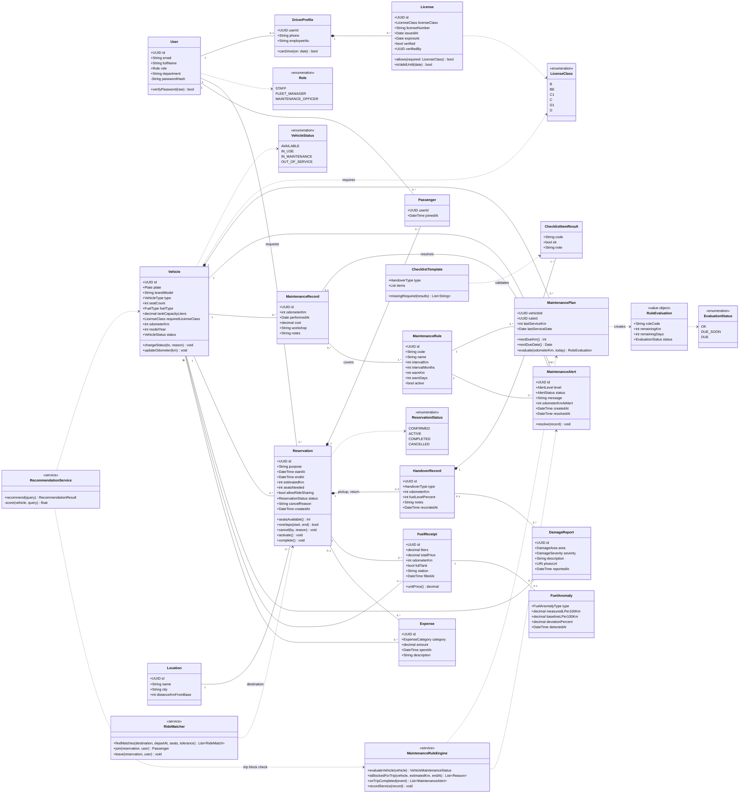

# FleetSync · UML Class Diagram (Domain Model)

| | |
|---|---|
| Responsible / Accountable | Ali Eren Kurt, Lead Software Architect & Technical Lead |
| Version | 1.0 · Sprint 2 · 2026-11-21 |
| Sources | [`openapi.yaml`](../openapi.yaml) `components/schemas`, [`system_vision.md`](../system_vision.md) §8, [`../c4/README.md`](../c4/README.md) §3 |
| Issue | #237 |

The diagram shows the domain classes of each backend module, their key attributes and the operations that carry business rules. API-only shapes (pages, request bodies, report rows) are left out; they are the Pydantic schemas generated from `openapi.yaml`. The tables behind these classes are in [`er_diagram.md`](er_diagram.md).

## 1. Domain model

## 2. Notes on the model

| Class | Rule it owns | Source |
|---|---|---|
| `License` | `allows()` uses the licence class hierarchy; `isValidUntil()` must hold for the trip end date. Only `verified` licences count. | `system_vision.md` §8 Driver eligibility |
| `Vehicle` | `updateOdometer()` rejects lower values (`ODOMETER_DECREASED`). `changeStatus()` allows only the manual transitions in [`state_diagrams.md`](state_diagrams.md) (`INVALID_STATUS_TRANSITION`). | `openapi.yaml` `changeVehicleStatus` |
| `MaintenancePlan` | Holds the last service km and date of one rule on one vehicle. `nextDueKm = lastServiceKm + intervalKm`, `nextDueDate = lastServiceDate + intervalMonths`. `evaluate()` returns `DUE` at the interval and `DUE_SOON` inside `warnKm` / `warnDays`. | `system_vision.md` §8, §12 |
| `MaintenanceRuleEngine` | `isBlockedForTrip()` blocks when `remainingKm < estimatedKm + 100` or `nextDueDate < endAt`. `onTripCompleted()` opens alerts and moves the vehicle to `IN_MAINTENANCE` when any rule is `DUE`. | `system_vision.md` §8 Trip blocking, Automatic maintenance status |
| `Reservation` | `overlaps()` uses half-open periods `[startAt, endAt)`, so back-to-back trips are allowed. `seatsAvailable() = vehicle.seatCount − seatsNeeded − passengers`. Only `CONFIRMED` can be cancelled. | `carpool_reservation_api.md` |
| `RideMatcher` | Same destination, departure within tolerance (default 30 min), `allowRideSharing`, at least one free seat. | `system_vision.md` §8 Ride sharing |
| `FuelReceipt` / `FuelAnomaly` | Litres above tank capacity rejected (`FUEL_EXCEEDS_TANK`); consumption > 25% above baseline flagged. | `system_vision.md` §8 Fuel anomaly |

`Plate`, `VehicleType`, `FuelType`, `HandoverType`, `DamageArea`, `DamageSeverity`, `AlertLevel`, `AlertStatus`, `FuelAnomalyType` and `ExpenseCategory` are enumerations or value types with the values listed in `openapi.yaml`; they are not drawn to keep the diagram readable.
