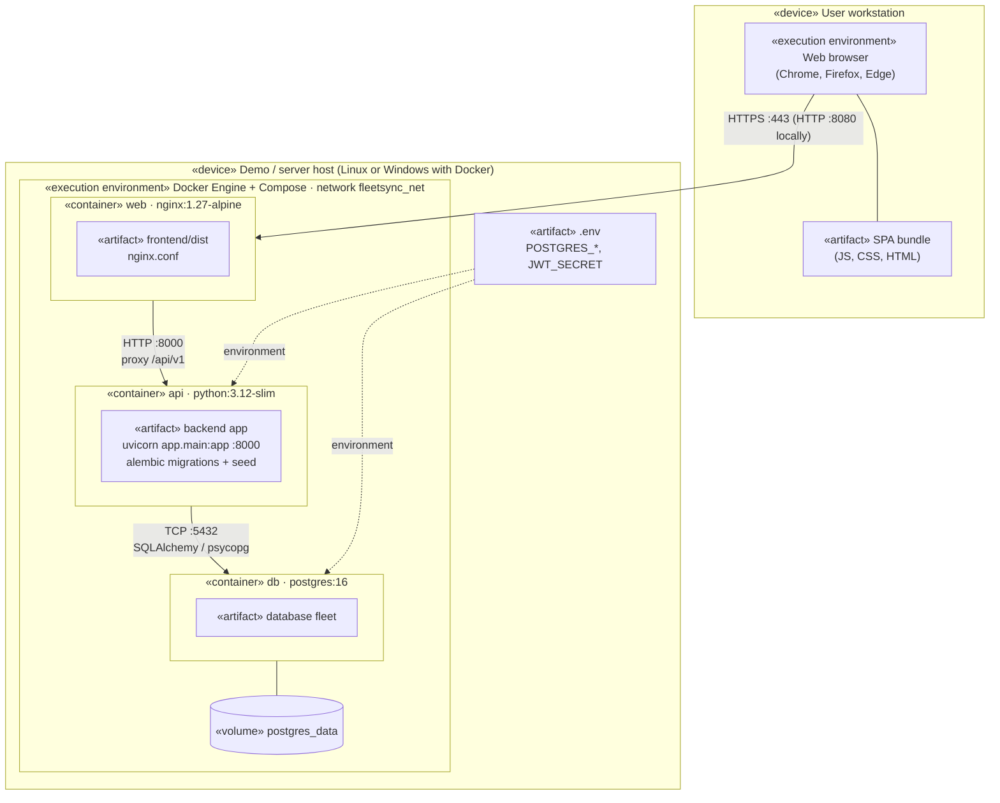
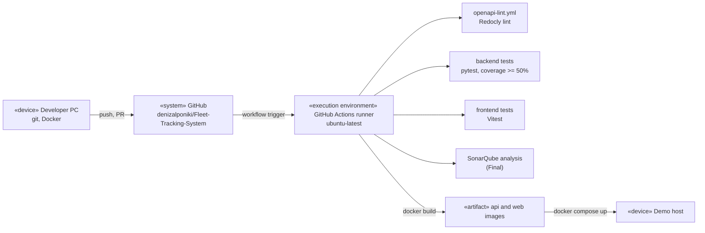

# FleetSync · UML Deployment Diagram

| | |
|---|---|
| Responsible / Accountable | Ali Eren Kurt, Lead Software Architect & Technical Lead |
| Consulted | Deniz Alp Oniki, DevOps & CI/CD Infrastructure Engineer (infrastructure input) |
| Version | 1.0 · Sprint 2 · 2026-11-21 |
| Sources | [`docker-compose.yml`](../../docker-compose.yml), [`.env.example`](../../.env.example), [`ci_cd_and_cost_reporting_api.md`](../ci_cd_and_cost_reporting_api.md), [`../c4/README.md`](../c4/README.md) §2 |
| Issue | #237 |

Release 1 runs on one host with Docker Compose: the jury demo and every developer start it with `docker compose up` (`system_vision.md` §10). Today `docker-compose.yml` contains only the `db` service; the `api` and `web` services below are the target for Sprint 3 and must be confirmed by DevOps (open point DD-1).

## 1. Runtime deployment (release 1)

| Node | Image / runtime | Exposed port | Depends on | Notes |
|---|---|---|---|---|
| `web` | `nginx` (Alpine) with the built SPA | `8080` on the host (HTTPS `443` when a certificate is configured) | `api` | Serves static files; proxies `/api/v1` to `api:8000`. |
| `api` | `python:3.12-slim`, FastAPI, Uvicorn | internal `8000` only | `db` (healthy) | Runs `alembic upgrade head` and loads demo seed data on start; reads `JWT_SECRET` and DB settings from `.env`. Stateless. |
| `db` | `postgres:16` | internal `5432` only (not published) | – | Data in the `postgres_data` volume; health check `pg_isready`. |

`openapi.yaml` lists `http://localhost:8080/api/v1` as the local server, which matches the `web` port above.

## 2. Build and delivery pipeline

The only workflow in the repository today is `.github/workflows/openapi-lint.yml`. Tests, coverage and image builds are added in Sprint 3 (US-46 to US-52).

## 3. Open points

| # | Point | Owner | Status |
|---|---|---|---|
| DD-1 | Add `api` and `web` services, health checks and the `fleetsync_net` network to `docker-compose.yml` | Deniz Alp Oniki | Open (Sprint 3) |
| DD-2 | Decide HTTPS for the demo (self-signed certificate or HTTP on localhost) | Deniz Alp Oniki, Ali Eren Kurt | Open |
| DD-3 | Add `JWT_SECRET` to `.env.example` | Deniz Alp Oniki | Open |
| DD-4 | Backup and recovery of `postgres_data` (`pg_dump`) is described in the NFR document | Deniz Alp Oniki | Open |
