# FleetSync · ER Diagram and Database Schema

| | |
|---|---|
| Responsible / Accountable | Ali Eren Kurt, Lead Software Architect & Technical Lead |
| Consulted | Ahmet Tarık Orhan (reservation, carpool), Deniz Alp Oniki (operations) |
| Version | 1.0 · Sprint 2 · 2026-11-21 |
| Database | PostgreSQL 16 (`docker-compose.yml` service `db`, database `fleet`) |
| Sources | [`openapi.yaml`](../openapi.yaml) `components/schemas`, [`class_diagram.md`](class_diagram.md), [`system_vision.md`](../system_vision.md) §8 |
| Issue | #238 |

## 1. Conventions

- Table names are singular `snake_case`, grouped by module with a prefix-free name; each module owns its tables and only its code writes to them (C4 Level 3, rule 1).
- Primary keys are `uuid` (`gen_random_uuid()`), matching the UUID identifiers in the API.
- Timestamps are `timestamptz`; dates are `date`. Money is `numeric(12,2)` in TRY.
- Enumerations are `text` columns with a `CHECK` constraint, so a new value is a migration and not a type change.
- Business rules that must never be broken under concurrency are enforced by the database as well as the service layer: no overlapping reservations, odometer readings, one open alert per vehicle and rule.
- The schema is created and changed only through Alembic migrations in `backend/migrations/` (Sprint 3).

## 2. ER diagram

```mermaid
erDiagram
    app_user ||--o| driver_profile : "has"
    driver_profile ||--o{ driving_license : "holds"
    app_user ||--o{ driving_license : "verifies"

    vehicle ||--o{ maintenance_plan : "has"
    maintenance_rule ||--o{ maintenance_plan : "applies to"
    vehicle ||--o{ maintenance_alert : "raises"
    maintenance_rule ||--o{ maintenance_alert : "for"
    vehicle ||--o{ maintenance_record : "serviced in"
    maintenance_record ||--|{ maintenance_record_rule : "covers"
    maintenance_rule ||--o{ maintenance_record_rule : "covered by"
    maintenance_record |o--o{ maintenance_alert : "resolves"
    app_user ||--o{ maintenance_record : "records"
    vehicle ||--o{ vehicle_status_change : "history"

    location ||--o{ reservation : "destination of"
    vehicle ||--o{ reservation : "booked in"
    app_user ||--o{ reservation : "requests"
    reservation ||--o{ ride_passenger : "carries"
    app_user ||--o{ ride_passenger : "joins as"

    reservation ||--o{ handover_record : "pickup and return"
    handover_record ||--|{ handover_item : "contains"
    app_user ||--o{ handover_record : "records"
    vehicle ||--o{ damage_report : "has"
    reservation |o--o{ damage_report : "during"
    handover_record |o--o{ damage_report : "reported at"
    app_user ||--o{ damage_report : "reports"

    vehicle ||--o{ fuel_receipt : "fuelled"
    reservation |o--o{ fuel_receipt : "during"
    fuel_receipt ||--o| fuel_anomaly : "flagged by"
    vehicle ||--o{ expense : "costs"
    reservation |o--o{ expense : "during"
    app_user ||--o{ fuel_receipt : "records"
    app_user ||--o{ expense : "records"

    app_user {
        uuid id PK
        text email UK
        text password_hash
        text full_name
        text role "STAFF | FLEET_MANAGER | MAINTENANCE_OFFICER"
        text department
        timestamptz created_at
    }
    driver_profile {
        uuid user_id PK, FK
        text phone
        text employee_no UK
    }
    driving_license {
        uuid id PK
        uuid driver_id FK
        text license_class "B | BE | C1 | C | D1 | D"
        text license_number UK
        date issued_at
        date expires_at
        boolean verified
        uuid verified_by FK
        timestamptz verified_at
    }
    vehicle {
        uuid id PK
        text plate UK
        text brand_model
        text vehicle_type
        int seat_count
        text fuel_type
        numeric tank_capacity_liters
        text required_license_class
        int odometer_km
        int model_year
        text status "AVAILABLE | IN_USE | IN_MAINTENANCE | OUT_OF_SERVICE"
        timestamptz created_at
    }
    vehicle_status_change {
        uuid id PK
        uuid vehicle_id FK
        text from_status
        text to_status
        text reason
        uuid changed_by FK
        timestamptz changed_at
    }
    maintenance_rule {
        uuid id PK
        text code UK
        text name
        int interval_km
        int interval_months
        int warn_km
        int warn_days
        boolean active
    }
    maintenance_plan {
        uuid vehicle_id PK, FK
        uuid rule_id PK, FK
        int last_service_km
        date last_service_date
    }
    maintenance_alert {
        uuid id PK
        uuid vehicle_id FK
        uuid rule_id FK
        text level "DUE_SOON | DUE"
        text status "OPEN | RESOLVED"
        text message
        int odometer_km_at_alert
        timestamptz created_at
        timestamptz resolved_at
        uuid resolved_by_record_id FK
    }
    maintenance_record {
        uuid id PK
        uuid vehicle_id FK
        int odometer_km
        date performed_at
        numeric cost
        text workshop
        text notes
        uuid recorded_by FK
        timestamptz created_at
    }
    maintenance_record_rule {
        uuid record_id PK, FK
        uuid rule_id PK, FK
    }
    location {
        uuid id PK
        text name UK
        text city
        int distance_km_from_base
    }
    reservation {
        uuid id PK
        uuid vehicle_id FK
        uuid requester_id FK
        uuid destination_id FK
        text purpose
        timestamptz start_at
        timestamptz end_at
        int estimated_km
        int seats_needed
        boolean allow_ride_sharing
        text status "CONFIRMED | ACTIVE | COMPLETED | CANCELLED"
        text cancel_reason
        timestamptz created_at
    }
    ride_passenger {
        uuid reservation_id PK, FK
        uuid user_id PK, FK
        timestamptz joined_at
    }
    handover_record {
        uuid id PK
        uuid reservation_id FK
        text type "PICKUP | RETURN"
        int odometer_km
        int fuel_level_percent
        text notes
        uuid recorded_by FK
        timestamptz recorded_at
    }
    handover_item {
        uuid handover_id PK, FK
        text code PK
        boolean ok
        text note
    }
    damage_report {
        uuid id PK
        uuid vehicle_id FK
        uuid reservation_id FK
        uuid handover_id FK
        text area
        text severity "MINOR | MODERATE | SEVERE"
        text description
        text photo_url
        uuid reported_by FK
        timestamptz reported_at
    }
    fuel_receipt {
        uuid id PK
        uuid vehicle_id FK
        uuid reservation_id FK
        numeric liters
        numeric total_price
        int odometer_km
        boolean full_tank
        text station
        timestamptz filled_at
        uuid recorded_by FK
    }
    fuel_anomaly {
        uuid receipt_id PK, FK
        text type "CONSUMPTION_SPIKE | OUTSIDE_RESERVATION"
        numeric measured_l_per_100km
        numeric baseline_l_per_100km
        numeric deviation_percent
        timestamptz detected_at
    }
    expense {
        uuid id PK
        uuid vehicle_id FK
        uuid reservation_id FK
        text category "TOLL | PARKING | CAR_WASH | BRIDGE | OTHER"
        numeric amount
        timestamptz spent_at
        text description
        uuid recorded_by FK
    }
```



Checklist templates (`GET /checklist-templates`) are static configuration in the `handover` module, not a table, because they change only with a release.

## 3. Mapping to modules and API

| Module | Tables | API schemas |
|---|---|---|
| `identity` | `app_user`, `driver_profile`, `driving_license` | `User`, `DriverProfile`, `License` |
| `vehicle` | `vehicle`, `vehicle_status_change` | `Vehicle`, `VehicleSummary`, `VehicleStatusChange` |
| `maintenance` | `maintenance_rule`, `maintenance_plan`, `maintenance_alert`, `maintenance_record`, `maintenance_record_rule` | `MaintenanceRule`, `RuleEvaluation`, `MaintenanceAlert`, `MaintenanceRecord`, `CalendarEntry` (computed) |
| `reservation` | `location`, `reservation` | `Location`, `Reservation` |
| `carpool` | `ride_passenger` | `Passenger`, `RideMatch` (computed) |
| `handover` | `handover_record`, `handover_item`, `damage_report` | `HandoverRecord`, `DamageReport` |
| `fuel` | `fuel_receipt`, `fuel_anomaly`, `expense` | `FuelReceipt`, `FuelAnomaly`, `Expense` |
| `reporting` | none (read-only queries and views) | `FleetSummary`, `CostReport`, `CarbonReport`, `UtilizationReport` |

Computed fields are not stored: `Reservation.seatsAvailable`, `RuleEvaluation.remainingKm/remainingDays`, `Vehicle.maintenance`, `FuelReceipt.unitPrice`, `ReturnResult.tripKm`, and every report.

## 4. Schema (DDL)

This is the reference for the first Alembic migration. Column types and constraints follow the limits in `openapi.yaml`.

```sql
CREATE EXTENSION IF NOT EXISTS btree_gist;   -- for the reservation exclusion constraint

-- ---------------------------------------------------------------- identity
CREATE TABLE app_user (
    id            uuid PRIMARY KEY DEFAULT gen_random_uuid(),
    email         text NOT NULL,
    password_hash text NOT NULL,                       -- bcrypt / argon2, never the password
    full_name     text NOT NULL CHECK (char_length(full_name) BETWEEN 2 AND 100),
    role          text NOT NULL CHECK (role IN ('STAFF','FLEET_MANAGER','MAINTENANCE_OFFICER')),
    department    text CHECK (char_length(department) <= 100),
    created_at    timestamptz NOT NULL DEFAULT now()
);
CREATE UNIQUE INDEX ux_app_user_email ON app_user (lower(email));   -- DUPLICATE_EMAIL

CREATE TABLE driver_profile (
    user_id     uuid PRIMARY KEY REFERENCES app_user(id) ON DELETE CASCADE,
    phone       text CHECK (char_length(phone) <= 20),
    employee_no text UNIQUE CHECK (char_length(employee_no) <= 20)
);

CREATE TABLE driving_license (
    id             uuid PRIMARY KEY DEFAULT gen_random_uuid(),
    driver_id      uuid NOT NULL REFERENCES driver_profile(user_id) ON DELETE CASCADE,
    license_class  text NOT NULL CHECK (license_class IN ('B','BE','C1','C','D1','D')),
    license_number text NOT NULL UNIQUE CHECK (char_length(license_number) BETWEEN 3 AND 20),  -- DUPLICATE_LICENSE
    issued_at      date NOT NULL,
    expires_at     date NOT NULL,
    verified       boolean NOT NULL DEFAULT false,
    verified_by    uuid REFERENCES app_user(id),
    verified_at    timestamptz,
    CHECK (expires_at > issued_at),
    CHECK (verified = (verified_by IS NOT NULL))
);
CREATE INDEX ix_driving_license_driver ON driving_license (driver_id);

-- ---------------------------------------------------------------- vehicle
CREATE TABLE vehicle (
    id                     uuid PRIMARY KEY DEFAULT gen_random_uuid(),
    plate                  text NOT NULL UNIQUE                                          -- DUPLICATE_PLATE
                           CHECK (plate ~ '^(0[1-9]|[1-7][0-9]|8[01]) [A-Z]{1,3} [0-9]{2,4}$'),
    brand_model            text CHECK (char_length(brand_model) <= 80),
    vehicle_type           text NOT NULL CHECK (vehicle_type IN ('SEDAN','HATCHBACK','SUV','MINIBUS','VAN','PICKUP')),
    seat_count             int  NOT NULL CHECK (seat_count BETWEEN 1 AND 60),
    fuel_type              text NOT NULL CHECK (fuel_type IN ('GASOLINE','DIESEL','HYBRID','ELECTRIC')),
    tank_capacity_liters   numeric(6,2) NOT NULL CHECK (tank_capacity_liters > 0 AND tank_capacity_liters <= 300),
    required_license_class text NOT NULL CHECK (required_license_class IN ('B','BE','C1','C','D1','D')),
    odometer_km            int  NOT NULL CHECK (odometer_km >= 0),
    model_year             int  CHECK (model_year BETWEEN 1990 AND 2030),
    status                 text NOT NULL DEFAULT 'AVAILABLE'
                           CHECK (status IN ('AVAILABLE','IN_USE','IN_MAINTENANCE','OUT_OF_SERVICE')),
    created_at             timestamptz NOT NULL DEFAULT now()
);
CREATE INDEX ix_vehicle_status ON vehicle (status);

CREATE TABLE vehicle_status_change (                    -- audit trail of the state machine
    id          uuid PRIMARY KEY DEFAULT gen_random_uuid(),
    vehicle_id  uuid NOT NULL REFERENCES vehicle(id) ON DELETE CASCADE,
    from_status text NOT NULL,
    to_status   text NOT NULL,
    reason      text NOT NULL CHECK (char_length(reason) BETWEEN 3 AND 300),
    changed_by  uuid REFERENCES app_user(id),            -- null when the system changes it
    changed_at  timestamptz NOT NULL DEFAULT now()
);
CREATE INDEX ix_vehicle_status_change_vehicle ON vehicle_status_change (vehicle_id, changed_at);

-- ---------------------------------------------------------------- maintenance
CREATE TABLE maintenance_rule (
    id              uuid PRIMARY KEY DEFAULT gen_random_uuid(),
    code            text NOT NULL UNIQUE CHECK (code ~ '^[A-Z_]+$'),
    name            text NOT NULL,
    interval_km     int CHECK (interval_km >= 1),
    interval_months int CHECK (interval_months >= 1),
    warn_km         int CHECK (warn_km >= 0),
    warn_days       int CHECK (warn_days >= 0),
    active          boolean NOT NULL DEFAULT true,
    CHECK (interval_km IS NOT NULL OR interval_months IS NOT NULL)
);

CREATE TABLE maintenance_plan (                         -- last service of one rule on one vehicle
    vehicle_id        uuid NOT NULL REFERENCES vehicle(id) ON DELETE CASCADE,
    rule_id           uuid NOT NULL REFERENCES maintenance_rule(id),
    last_service_km   int  NOT NULL CHECK (last_service_km >= 0),
    last_service_date date NOT NULL,
    PRIMARY KEY (vehicle_id, rule_id)
);

CREATE TABLE maintenance_record (
    id           uuid PRIMARY KEY DEFAULT gen_random_uuid(),
    vehicle_id   uuid NOT NULL REFERENCES vehicle(id),
    odometer_km  int  NOT NULL CHECK (odometer_km >= 0),
    performed_at date NOT NULL,
    cost         numeric(12,2) CHECK (cost >= 0),
    workshop     text CHECK (char_length(workshop) <= 120),
    notes        text CHECK (char_length(notes) <= 1000),
    recorded_by  uuid NOT NULL REFERENCES app_user(id),
    created_at   timestamptz NOT NULL DEFAULT now()
);
CREATE INDEX ix_maintenance_record_vehicle ON maintenance_record (vehicle_id, performed_at DESC);

CREATE TABLE maintenance_record_rule (
    record_id uuid NOT NULL REFERENCES maintenance_record(id) ON DELETE CASCADE,
    rule_id   uuid NOT NULL REFERENCES maintenance_rule(id),
    PRIMARY KEY (record_id, rule_id)
);

CREATE TABLE maintenance_alert (
    id                    uuid PRIMARY KEY DEFAULT gen_random_uuid(),
    vehicle_id            uuid NOT NULL REFERENCES vehicle(id),
    rule_id               uuid NOT NULL REFERENCES maintenance_rule(id),
    level                 text NOT NULL CHECK (level IN ('DUE_SOON','DUE')),
    status                text NOT NULL DEFAULT 'OPEN' CHECK (status IN ('OPEN','RESOLVED')),
    message               text NOT NULL,
    odometer_km_at_alert  int,
    created_at            timestamptz NOT NULL DEFAULT now(),
    resolved_at           timestamptz,
    resolved_by_record_id uuid REFERENCES maintenance_record(id),
    CHECK ((status = 'RESOLVED') = (resolved_at IS NOT NULL))
);
-- at most one open alert per vehicle and rule (state_diagrams.md §3)
CREATE UNIQUE INDEX ux_maintenance_alert_open ON maintenance_alert (vehicle_id, rule_id) WHERE status = 'OPEN';
CREATE INDEX ix_maintenance_alert_status ON maintenance_alert (status, created_at DESC);

-- ---------------------------------------------------------------- reservation
CREATE TABLE location (
    id                    uuid PRIMARY KEY DEFAULT gen_random_uuid(),
    name                  text NOT NULL UNIQUE,
    city                  text NOT NULL,
    distance_km_from_base int  NOT NULL CHECK (distance_km_from_base >= 0)
);

CREATE TABLE reservation (
    id                 uuid PRIMARY KEY DEFAULT gen_random_uuid(),
    vehicle_id         uuid NOT NULL REFERENCES vehicle(id),
    requester_id       uuid NOT NULL REFERENCES app_user(id),
    destination_id     uuid NOT NULL REFERENCES location(id),
    purpose            text NOT NULL CHECK (char_length(purpose) BETWEEN 3 AND 200),
    start_at           timestamptz NOT NULL,
    end_at             timestamptz NOT NULL,
    estimated_km       int  NOT NULL CHECK (estimated_km BETWEEN 1 AND 5000),
    seats_needed       int  NOT NULL CHECK (seats_needed BETWEEN 1 AND 60),
    allow_ride_sharing boolean NOT NULL DEFAULT true,
    status             text NOT NULL DEFAULT 'CONFIRMED'
                       CHECK (status IN ('CONFIRMED','ACTIVE','COMPLETED','CANCELLED')),
    cancel_reason      text CHECK (char_length(cancel_reason) <= 300),
    created_at         timestamptz NOT NULL DEFAULT now(),
    CHECK (end_at > start_at AND end_at <= start_at + interval '14 days'),
    -- No double booking (system_vision.md §8). Half-open range [start, end): back-to-back trips are allowed.
    -- A violation raises SQLSTATE 23P01, mapped to 409 RESERVATION_CONFLICT.
    CONSTRAINT ex_reservation_no_overlap EXCLUDE USING gist (
        vehicle_id WITH =,
        tstzrange(start_at, end_at, '[)') WITH &&
    ) WHERE (status IN ('CONFIRMED','ACTIVE'))
);
CREATE INDEX ix_reservation_requester   ON reservation (requester_id, start_at DESC);
CREATE INDEX ix_reservation_destination ON reservation (destination_id, start_at) WHERE status = 'CONFIRMED';  -- ride matching

-- ---------------------------------------------------------------- carpool
CREATE TABLE ride_passenger (
    reservation_id uuid NOT NULL REFERENCES reservation(id) ON DELETE CASCADE,
    user_id        uuid NOT NULL REFERENCES app_user(id),
    joined_at      timestamptz NOT NULL DEFAULT now(),
    PRIMARY KEY (reservation_id, user_id)               -- ALREADY_JOINED
);
-- seat capacity (seat_count - seats_needed - passengers >= 0) is checked in the service
-- while the reservation row is locked with SELECT ... FOR UPDATE (sequence_diagrams.md SD-4).

-- ---------------------------------------------------------------- handover
CREATE TABLE handover_record (
    id                 uuid PRIMARY KEY DEFAULT gen_random_uuid(),
    reservation_id     uuid NOT NULL REFERENCES reservation(id),
    type               text NOT NULL CHECK (type IN ('PICKUP','RETURN')),
    odometer_km        int  NOT NULL CHECK (odometer_km >= 0),
    fuel_level_percent int  NOT NULL CHECK (fuel_level_percent BETWEEN 0 AND 100),
    notes              text CHECK (char_length(notes) <= 500),
    recorded_by        uuid NOT NULL REFERENCES app_user(id),
    recorded_at        timestamptz NOT NULL DEFAULT now(),
    UNIQUE (reservation_id, type)                        -- one pickup and one return per reservation
);

CREATE TABLE handover_item (
    handover_id uuid NOT NULL REFERENCES handover_record(id) ON DELETE CASCADE,
    code        text NOT NULL,
    ok          boolean NOT NULL,
    note        text CHECK (char_length(note) <= 300),
    PRIMARY KEY (handover_id, code)
);

CREATE TABLE damage_report (
    id             uuid PRIMARY KEY DEFAULT gen_random_uuid(),
    vehicle_id     uuid NOT NULL REFERENCES vehicle(id),
    reservation_id uuid REFERENCES reservation(id),
    handover_id    uuid REFERENCES handover_record(id),
    area           text NOT NULL CHECK (area IN ('FRONT','REAR','LEFT','RIGHT','ROOF','INTERIOR','WINDSHIELD','TIRES','OTHER')),
    severity       text NOT NULL CHECK (severity IN ('MINOR','MODERATE','SEVERE')),
    description    text NOT NULL CHECK (char_length(description) BETWEEN 3 AND 500),
    photo_url      text,
    reported_by    uuid NOT NULL REFERENCES app_user(id),
    reported_at    timestamptz NOT NULL DEFAULT now()
);
CREATE INDEX ix_damage_report_vehicle ON damage_report (vehicle_id, reported_at DESC);

-- ---------------------------------------------------------------- fuel
CREATE TABLE fuel_receipt (
    id             uuid PRIMARY KEY DEFAULT gen_random_uuid(),
    vehicle_id     uuid NOT NULL REFERENCES vehicle(id),
    reservation_id uuid REFERENCES reservation(id),
    liters         numeric(6,2)  NOT NULL CHECK (liters > 0),          -- <= tank capacity checked in service: FUEL_EXCEEDS_TANK
    total_price    numeric(12,2) NOT NULL CHECK (total_price > 0),
    odometer_km    int NOT NULL CHECK (odometer_km >= 0),
    full_tank      boolean NOT NULL,
    station        text CHECK (char_length(station) <= 120),
    filled_at      timestamptz NOT NULL,
    recorded_by    uuid NOT NULL REFERENCES app_user(id)
);
CREATE INDEX ix_fuel_receipt_vehicle ON fuel_receipt (vehicle_id, odometer_km);

CREATE TABLE fuel_anomaly (
    receipt_id           uuid PRIMARY KEY REFERENCES fuel_receipt(id) ON DELETE CASCADE,
    type                 text NOT NULL CHECK (type IN ('CONSUMPTION_SPIKE','OUTSIDE_RESERVATION')),
    measured_l_per_100km numeric(6,2),
    baseline_l_per_100km numeric(6,2),
    deviation_percent    numeric(6,2),
    detected_at          timestamptz NOT NULL DEFAULT now()
);

CREATE TABLE expense (
    id             uuid PRIMARY KEY DEFAULT gen_random_uuid(),
    vehicle_id     uuid NOT NULL REFERENCES vehicle(id),
    reservation_id uuid REFERENCES reservation(id),
    category       text NOT NULL CHECK (category IN ('TOLL','PARKING','CAR_WASH','BRIDGE','OTHER')),
    amount         numeric(12,2) NOT NULL CHECK (amount > 0),
    spent_at       timestamptz NOT NULL,
    description    text CHECK (char_length(description) <= 300),
    recorded_by    uuid NOT NULL REFERENCES app_user(id)
);
CREATE INDEX ix_expense_vehicle ON expense (vehicle_id, spent_at);
```

## 5. Rules enforced in the database

| Rule (`system_vision.md` §8) | How | Error code |
|---|---|---|
| No double booking | `ex_reservation_no_overlap` exclusion constraint on `reservation` | `409 RESERVATION_CONFLICT` |
| One open alert per vehicle and rule | `ux_maintenance_alert_open` partial unique index | – (the engine raises the level instead) |
| No duplicate plate / email / licence | unique constraints | `409 DUPLICATE_PLATE`, `DUPLICATE_EMAIL`, `DUPLICATE_LICENSE` |
| A passenger joins once | primary key of `ride_passenger` | `409 ALREADY_JOINED` |
| One pickup and one return | `UNIQUE (reservation_id, type)` on `handover_record` | `409 INVALID_RESERVATION_STATE` |
| Reservation period at most 14 days | `CHECK` on `reservation` | `400 VALIDATION_ERROR` |

Rules that need data from more than one row (odometer never decreases, seat capacity, fuel above tank capacity, licence class) are checked in the service layer while the relevant row is locked, and covered by unit tests.

## 6. Seed data for the demo

The first migration seeds the three default maintenance rules from `system_vision.md` §8 (`OIL_CHANGE` 10,000 km / 12 months, `TIRE_LIFE` 40,000 km / 48 months, `INSPECTION` 24 months). The demo seed adds invented users for the three roles, the destinations in `GET /locations`, and the vehicles used in `api_usage.md` (for example `06 FS 102` at 59,450 km with its last oil service at 50,000 km, so a 570 km trip triggers the alert in demo step 5). No real personal data is stored (KVKK, `system_vision.md` §10).
