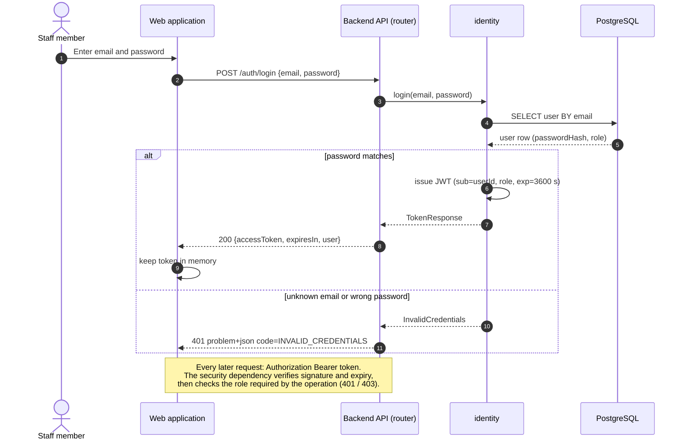
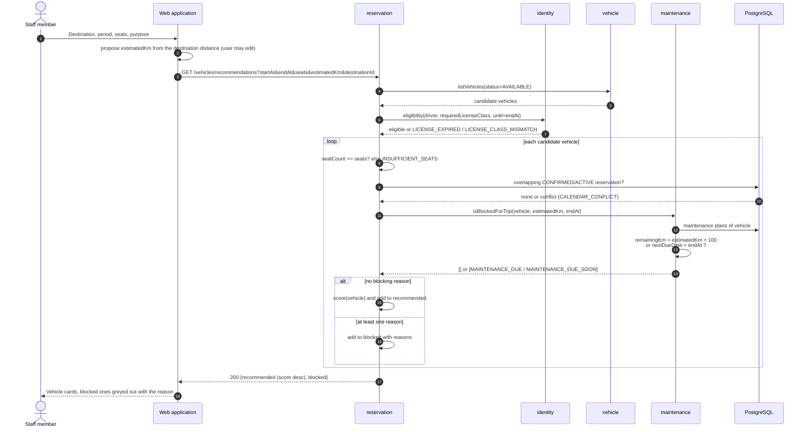
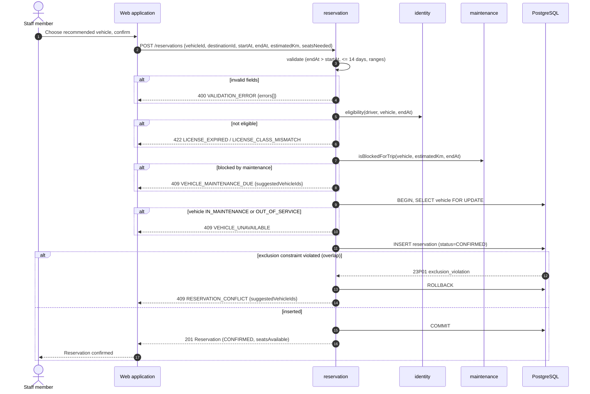
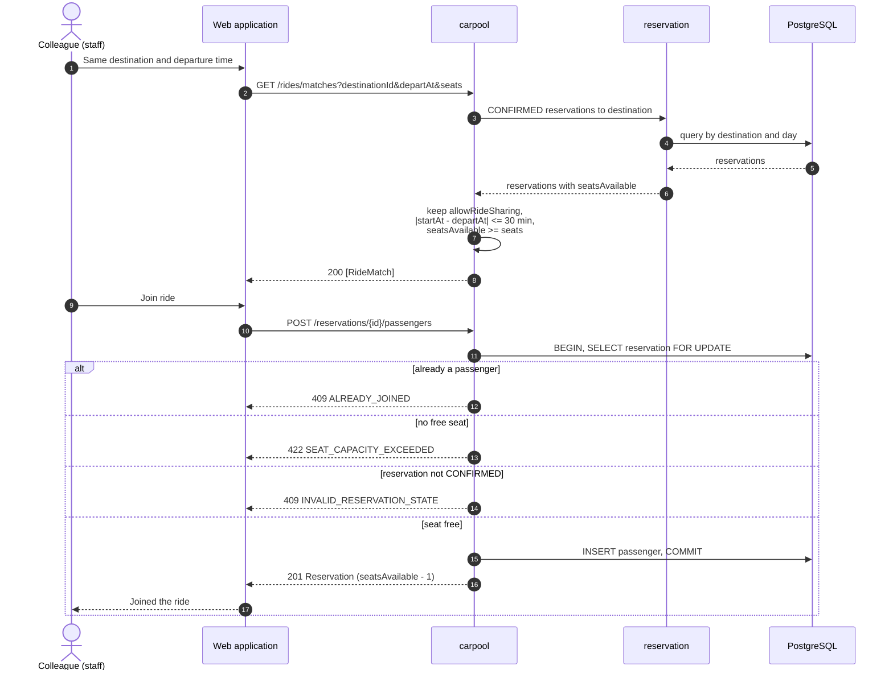
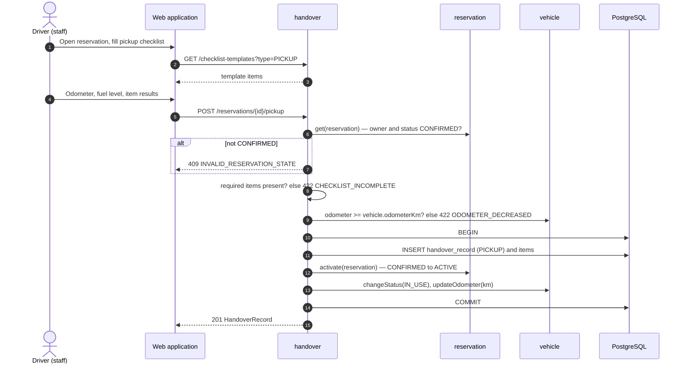
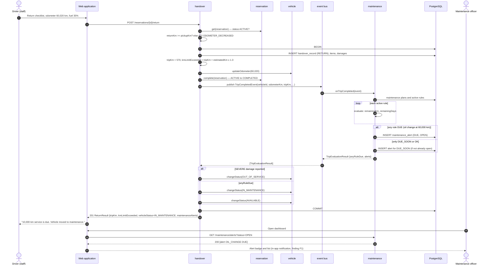
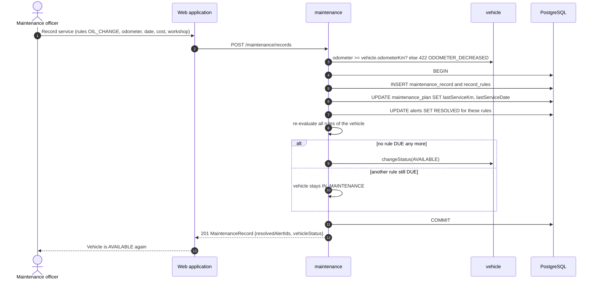

# FleetSync · UML Sequence Diagrams

| | |
|---|---|
| Responsible / Accountable | Ali Eren Kurt, Lead Software Architect & Technical Lead |
| Consulted | Ahmet Tarık Orhan (reservation, carpool), Mehmet Umut Oğuzcan (handover) |
| Version | 1.0 · Sprint 2 · 2026-11-21 |
| Sources | [`openapi.yaml`](../openapi.yaml), [`carpool_reservation_api.md`](../carpool_reservation_api.md), [`system_vision.md`](../system_vision.md) §8 and §11, [`../c4/README.md`](../c4/README.md) §3 |
| Issue | #237 |

The diagrams follow the jury demo flow (`system_vision.md` §11). Participants are the containers and backend modules from the C4 Level 3 diagram. Every call from the SPA carries `Authorization: Bearer <JWT>`; the security check is drawn once in SD-1 and omitted afterwards.

| # | Scenario | Demo step | User stories |
|---|---|---|---|
| SD-1 | Log in | – | US-01 |
| SD-2 | Get recommendations (a vehicle is blocked) | 1–2 | US-19 |
| SD-3 | Create a reservation (conflict prevention) | 2 | US-20 |
| SD-4 | Find and join a shared ride | 3 | US-23, US-24 |
| SD-5 | Pick up the vehicle | 4 | handover |
| SD-6 | Return the vehicle and run the maintenance rule engine | 5 | US-13, handover |
| SD-7 | Record a service and release the vehicle | 6 | US-15 |

## SD-1 · Log in

## SD-2 · Get recommendations

The staff member asks for a 9-seat vehicle to Konya. One minibus has only 550 km left before its oil service, so it is blocked with a reason (demo step 2).

## SD-3 · Create a reservation

The server repeats every check, because the client may be stale. The no-overlap rule is enforced by the database constraint as well (see [`er_diagram.md`](er_diagram.md)), so two concurrent requests cannot both succeed.

## SD-4 · Find and join a shared ride

## SD-5 · Pick up the vehicle

## SD-6 · Return the vehicle and run the maintenance rule engine

This is the core of demo step 5. The return and the maintenance evaluation run in the same transaction (`openapi.yaml` `recordReturn`). The event payload and the rule for the final vehicle status are defined in [`domain_events.md`](../domain_events.md).

## SD-7 · Record a service and release the vehicle

