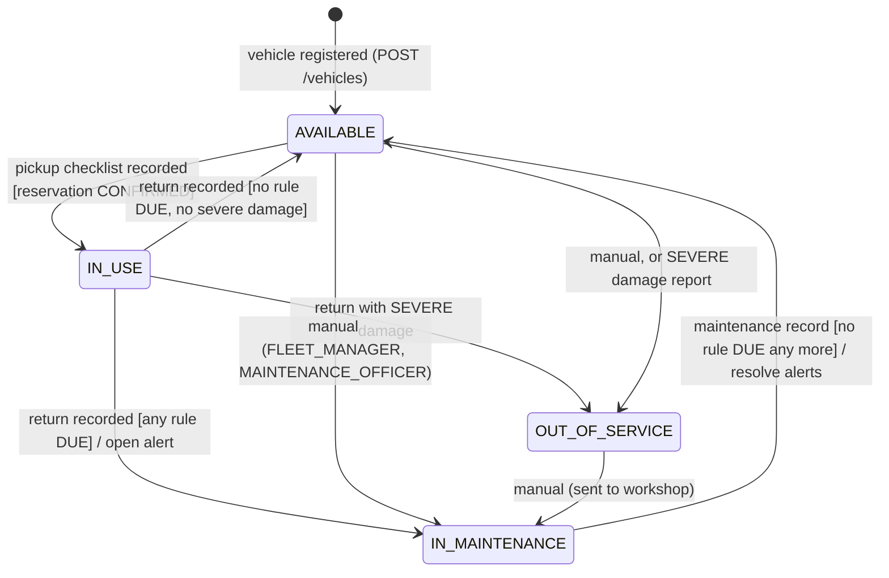
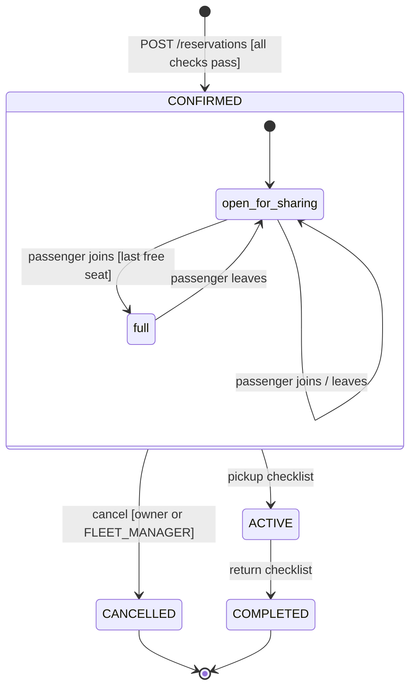
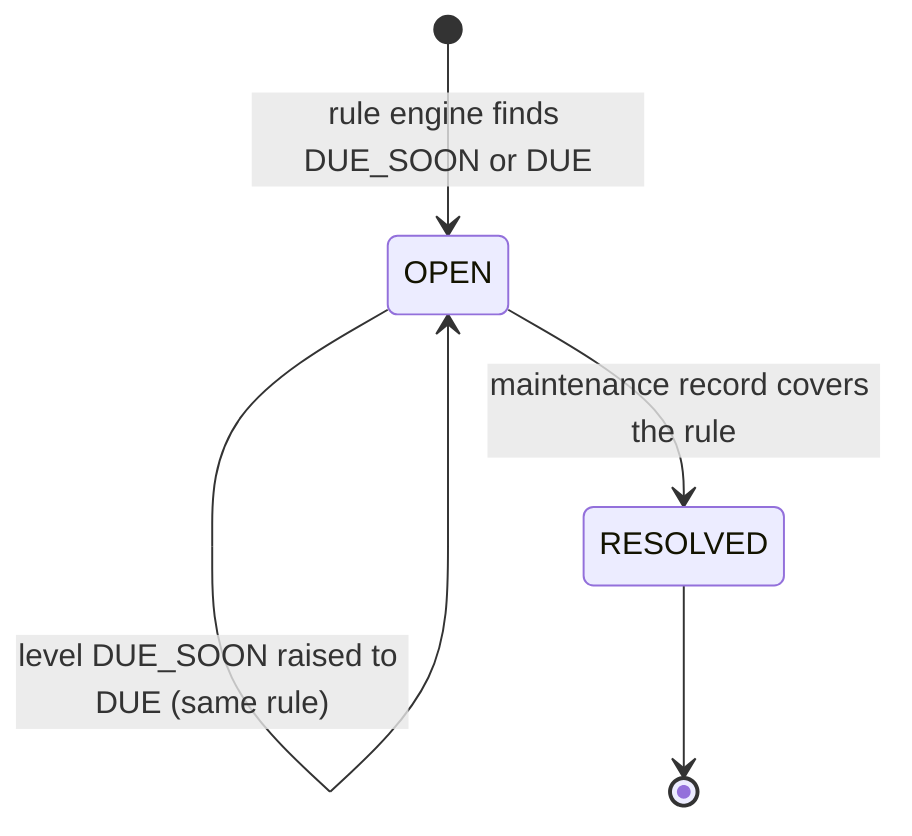
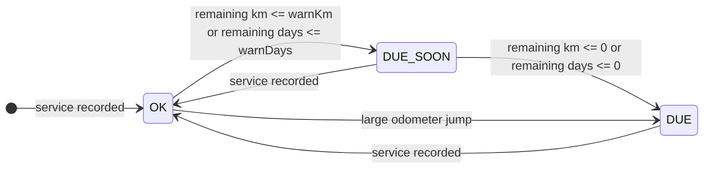

# FleetSync · UML State Diagrams

| | |
|---|---|
| Responsible / Accountable | Ali Eren Kurt, Lead Software Architect & Technical Lead |
| Version | 1.0 · Sprint 2 · 2026-11-21 |
| Sources | [`openapi.yaml`](../openapi.yaml) (`changeVehicleStatus`, `recordPickup`, `recordReturn`, `createDamageReport`, `cancelReservation`), [`system_vision.md`](../system_vision.md) §8 |
| Issue | #237 |

Each diagram is the single definition of the allowed transitions. The backend implements them in the owning class (`Vehicle.changeStatus`, `Reservation`, `MaintenanceAlert`); any other transition is rejected with the error code shown.

## 1. Vehicle status

| Transition | Trigger | Who | Endpoint |
|---|---|---|---|
| `AVAILABLE → IN_USE` | Pickup checklist | Driver | `POST /reservations/{id}/pickup` |
| `IN_USE → AVAILABLE` / `IN_MAINTENANCE` | Return; the rule engine decides | Driver (system decides) | `POST /reservations/{id}/return` |
| `IN_USE → OUT_OF_SERVICE` | Return with a `SEVERE` damage | Driver (system decides) | `POST /reservations/{id}/return` |
| `AVAILABLE → IN_MAINTENANCE` | Manual | Fleet manager, maintenance officer | `POST /vehicles/{id}/status` |
| `AVAILABLE → OUT_OF_SERVICE` | Manual, or a `SEVERE` damage report | Fleet manager, maintenance officer; any user for a damage report | `POST /vehicles/{id}/status`, `POST /damage-reports` |
| `OUT_OF_SERVICE → IN_MAINTENANCE` | Manual | Fleet manager, maintenance officer | `POST /vehicles/{id}/status` |
| `IN_MAINTENANCE → AVAILABLE` | Service record clears every `DUE` rule | Maintenance officer | `POST /maintenance/records` |

Any other request on `POST /vehicles/{id}/status` returns `409 INVALID_STATUS_TRANSITION`. Transitions into and out of `IN_USE` happen only through handover; `IN_MAINTENANCE → AVAILABLE` only through a maintenance record.

> Open point (SM-1): a `SEVERE` damage report on an `IN_USE` vehicle outside a handover. Proposal: the report is stored and the status change is applied at return. To be confirmed with Mehmet Umut Oğuzcan (handover owner).

## 2. Reservation status

| From | Request | Result |
|---|---|---|
| `CONFIRMED` | cancel | `CANCELLED`, period freed for others |
| `ACTIVE`, `COMPLETED`, `CANCELLED` | cancel | `409 RESERVATION_NOT_CANCELLABLE` |
| not `CONFIRMED` | pickup | `409 INVALID_RESERVATION_STATE` |
| not `ACTIVE` | return | `409 INVALID_RESERVATION_STATE` |
| `ACTIVE` | remove passenger | `409 INVALID_RESERVATION_STATE` |

Passengers can join or leave only while the reservation is `CONFIRMED`. The nested state is not stored; it is derived from `seatsAvailable`.

## 3. Maintenance alert

At most one `OPEN` alert exists per vehicle and rule (unique partial index in [`er_diagram.md`](er_diagram.md)). If a `DUE_SOON` alert is open and the rule becomes `DUE`, the same alert is raised to level `DUE` instead of opening a second one.

## 4. Rule evaluation for one vehicle and rule

Default thresholds (data, changeable by the fleet manager): oil change 10,000 km / 12 months, warn 1,000 km / 30 days; tyres 40,000 km / 48 months, warn 2,000 km / 60 days; inspection 24 months, warn 30 days.
