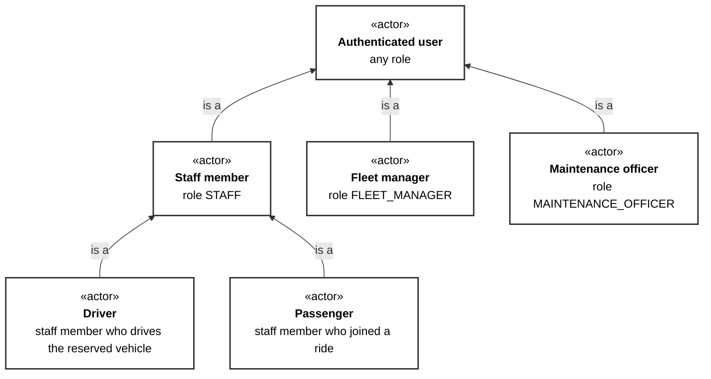
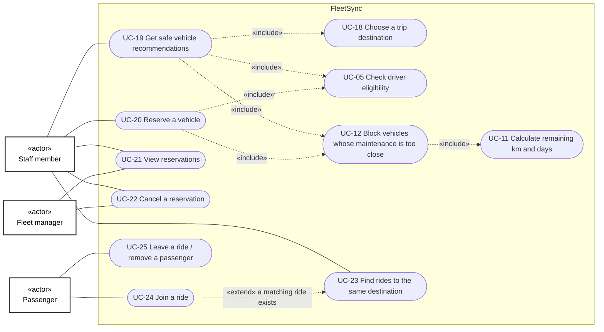
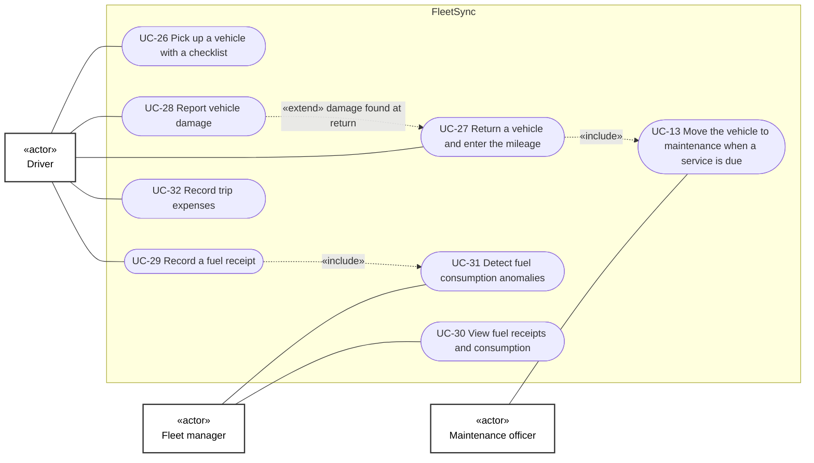
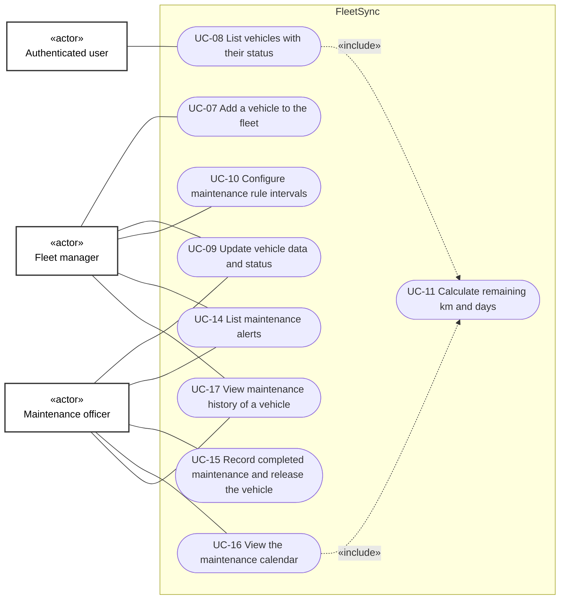
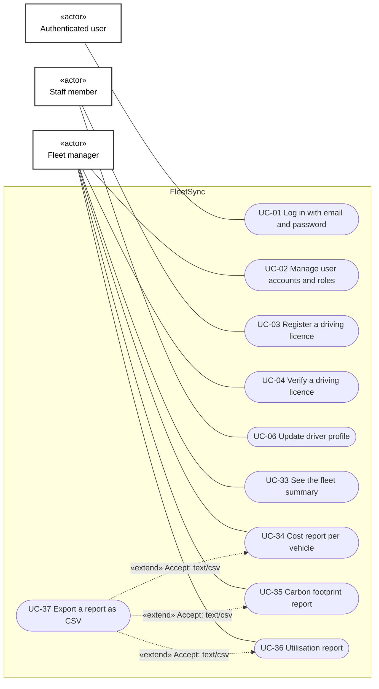

# FleetSync · UML Use Case Diagram

| | |
|---|---|
| Course | SENG 321 Software Engineering · Sprint 2 (deliverables 1 and 4) |
| Responsible | Ali Eren Kurt, Lead Software Architect & Technical Lead |
| Consulted | Ahmet Can Vurmaz, Product Owner & Requirements Engineer (stories and actors) |
| Version | 1.0 · Sprint 2 · 2026-11-21 |
| Sources | [`product_backlog.md`](../product_backlog.md) US-01 – US-37, [`system_vision.md`](../system_vision.md) §5 and §7.1, [`srs/srs.md`](../srs/srs.md), [`openapi.yaml`](../openapi.yaml) |
| Issue | #286 |

The diagrams show what each user can do with FleetSync in release 1. **Use case `UC-nn` is user story `US-nn`**, so every use case traces directly to its story, its acceptance criteria and its tests. US-38 – US-45 (screens) and US-46 – US-52 (delivery and quality) are not separate use cases: the screens realise the use cases below and the delivery stories have no external actor.

Mermaid has no native use case notation, so the diagrams use flowchart shapes with the UML meaning:

| Shape | UML element |
|---|---|
| Rectangle «actor» | Actor |
| Rounded box `UC-nn …` | Use case |
| Frame "FleetSync" | System boundary |
| Solid line | Association (actor takes part in the use case) |
| Dashed arrow «include» | The base use case always performs the included one |
| Dashed arrow «extend» | The extension is optional, under a condition, and points to the base use case |
| Arrow with hollow head "is a" | Actor generalisation |

## 1. Actors

| Actor | Role in the API | Description |
|---|---|---|
| Authenticated user | any | Anyone signed in; inherits nothing but login and the vehicle list |
| Staff member | `STAFF` | Requests and reserves vehicles, joins shared rides (`system_vision.md` §5.1) |
| Driver | `STAFF` | The staff member who owns a reservation and drives the vehicle |
| Passenger | `STAFF` | A staff member who joined another person's ride |
| Fleet manager | `FLEET_MANAGER` | Master data, licence verification, all reservations, reports |
| Maintenance officer | `MAINTENANCE_OFFICER` | Alerts, calendar, service records |

Driver and passenger are not separate roles: they are what a staff member is in relation to a particular reservation. There are no external system actors in release 1 (`system_vision.md` §7.2).

## 2. Trip request, reservation and ride sharing

## 3. Vehicle handover, fuel and expenses

The maintenance officer is associated with UC-13 as the actor who receives its result: the open alert (in-app notification, ADR-006).

## 4. Fleet inventory and maintenance

## 5. Accounts, licences and reports

Every use case except UC-01 requires a signed-in user; this precondition is not drawn as an «include» on each use case.

## 6. Use case catalogue

| UC | Use case | Primary actor | Supporting / receiving actor | Relations | Endpoint(s) | Priority |
|---|---|---|---|---|---|---|
| UC-01 | Log in with email and password | Authenticated user | – | – | `POST /auth/login`, `GET /me` | Must |
| UC-02 | Manage user accounts and roles | Fleet manager | – | – | `GET/POST /users` | Must |
| UC-03 | Register a driving licence | Staff member | Fleet manager (verifies, UC-04) | – | `POST /drivers/{driverId}/licenses` | Must |
| UC-04 | Verify a driving licence | Fleet manager | – | – | `POST /drivers/{driverId}/licenses/{licenseId}/verify` | Must |
| UC-05 | Check driver eligibility | – (included) | – | included by UC-19, UC-20 | `GET /drivers/{driverId}/eligibility` | Must |
| UC-06 | Update driver profile | Staff member | – | – | `PUT /drivers/{driverId}` | Could |
| UC-07 | Add a vehicle to the fleet | Fleet manager | – | – | `POST /vehicles` | Must |
| UC-08 | List vehicles with their status | Authenticated user | – | includes UC-11 | `GET /vehicles`, `GET /vehicles/{vehicleId}` | Must |
| UC-09 | Update vehicle data and status | Fleet manager | Maintenance officer | – | `PATCH /vehicles/{vehicleId}`, `POST /vehicles/{vehicleId}/status` | Should |
| UC-10 | Configure maintenance rule intervals | Fleet manager | – | – | `GET /maintenance/rules`, `PUT /maintenance/rules/{ruleId}` | Should |
| UC-11 | Calculate remaining km and days | – (included) | – | included by UC-08, UC-12, UC-16 | `GET /vehicles/{vehicleId}/maintenance-status` | Must |
| UC-12 | Block vehicles whose maintenance is too close | – (included) | – | included by UC-19, UC-20; includes UC-11 | inside `GET /vehicles/recommendations`, `POST /reservations` | Must |
| UC-13 | Move the vehicle to maintenance when a service is due | – (included) | Maintenance officer (receives the alert) | included by UC-27 | inside `POST /reservations/{reservationId}/return` | Must |
| UC-14 | List maintenance alerts | Maintenance officer | Fleet manager | – | `GET /maintenance/alerts` | Must |
| UC-15 | Record completed maintenance and release the vehicle | Maintenance officer | – | – | `POST /maintenance/records` | Must |
| UC-16 | View the maintenance calendar | Maintenance officer | – | includes UC-11 | `GET /maintenance/calendar` | Should |
| UC-17 | View maintenance history of a vehicle | Fleet manager | Maintenance officer | – | `GET /vehicles/{vehicleId}/maintenance-records` | Could |
| UC-18 | Choose a trip destination | – (included) | – | included by UC-19 | `GET /locations` | Must |
| UC-19 | Get safe vehicle recommendations | Staff member | – | includes UC-05, UC-12, UC-18 | `GET /vehicles/recommendations` | Must |
| UC-20 | Reserve a vehicle | Staff member | – | includes UC-05, UC-12 | `POST /reservations` | Must |
| UC-21 | View reservations | Staff member (own) | Fleet manager (all) | – | `GET /reservations`, `GET /reservations/{reservationId}` | Must |
| UC-22 | Cancel a reservation | Staff member (owner) | Fleet manager | – | `POST /reservations/{reservationId}/cancel` | Should |
| UC-23 | Find rides to the same destination | Staff member | – | extended by UC-24 | `GET /rides/matches` | Must |
| UC-24 | Join a ride | Passenger | – | extends UC-23 (a matching ride exists) | `POST /reservations/{reservationId}/passengers` | Must |
| UC-25 | Leave a ride / remove a passenger | Passenger | Driver, Fleet manager | – | `DELETE /reservations/{reservationId}/passengers/{userId}` | Could |
| UC-26 | Pick up a vehicle with a checklist | Driver | – | – | `GET /checklist-templates`, `POST /reservations/{reservationId}/pickup` | Must |
| UC-27 | Return a vehicle and enter the mileage | Driver | – | includes UC-13; extended by UC-28 | `POST /reservations/{reservationId}/return` | Must |
| UC-28 | Report vehicle damage | Driver | – | extends UC-27 (damage found at return); also on its own | `POST /damage-reports`, `GET /vehicles/{vehicleId}/damage-reports` | Should |
| UC-29 | Record a fuel receipt | Driver | – | includes UC-31 | `POST /fuel-receipts` | Must |
| UC-30 | View fuel receipts and consumption | Fleet manager | – | – | `GET /vehicles/{vehicleId}/fuel-receipts`, `GET /vehicles/{vehicleId}/consumption` | Should |
| UC-31 | Detect fuel consumption anomalies | Fleet manager (views) | – | included by UC-29 | `GET /fuel/anomalies` | Should |
| UC-32 | Record trip expenses | Driver | – | – | `GET/POST /expenses` | Could |
| UC-33 | See the fleet summary | Fleet manager | – | – | `GET /reports/summary` | Should |
| UC-34 | Cost report per vehicle | Fleet manager | – | extended by UC-37 | `GET /reports/cost` | Must |
| UC-35 | Carbon footprint report | Fleet manager | – | extended by UC-37 | `GET /reports/carbon` | Must |
| UC-36 | Utilisation report | Fleet manager | – | extended by UC-37 | `GET /reports/utilization` | Must |
| UC-37 | Export a report as CSV | Fleet manager | – | extends UC-34, UC-35, UC-36 | same paths with `Accept: text/csv` | Could |

Priorities are copied from `product_backlog.md`. Use cases with "– (included)" as primary actor are performed by the system inside another use case; they have no actor of their own.

## 7. Jury demo path

The demo (`system_vision.md` §11) walks through these use cases in order:

UC-01 → UC-19 (UC-18, UC-05, UC-12, UC-11) → UC-20 → UC-23 → UC-24 → UC-26 → UC-27 (UC-13) → UC-14 → UC-15 → UC-34, UC-35, UC-36

The same path is drawn step by step in [`sequence_diagrams.md`](sequence_diagrams.md) SD-1 – SD-7.
